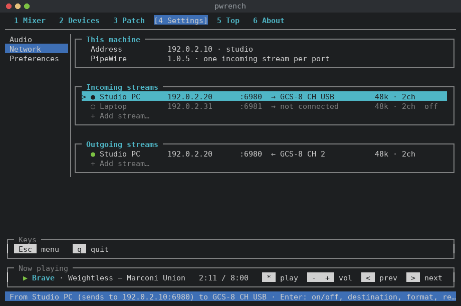
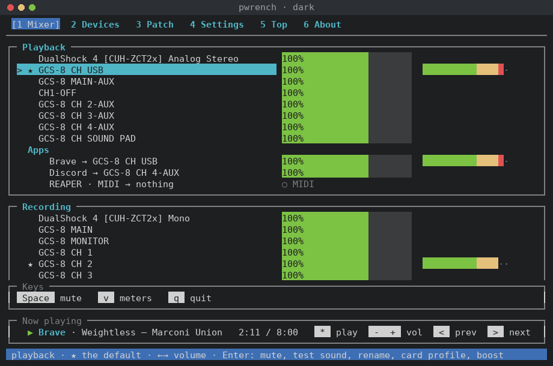

# PipeWrench

**A terminal control panel for PipeWire, the sound system on modern Linux.** Levels, devices, routing, the
audio clock and network audio, on one screen you can drive with the keyboard, the mouse or a touchscreen.
It runs the same in a desktop terminal, over SSH, in a tmux pane next to your DAW, or on a machine with no
desktop at all.


[Why it exists](#why-it-exists) · [Overview](#overview) ·
[Where it fits](#where-it-fits) · [Install](#install) · [Run](#run) · [Command line](#command-line) ·
[Where it keeps things](#where-it-keeps-things) · [Licence](#licence) · **[User guide](docs/guide.md)**

## Why it exists

I've been using Linux as my daily driver since 2017. I've run most flavors of Ubuntu, Fedora, openSUSE, and
even dabbled in Arch. I'm a musician, podcaster, and an amateur audio engineer. Over the years one thing
was always the common issue with Linux and audio. Linux could always do the job, but getting under the hood
was the only way. Few apps could easily and intuitively expose the capabilities of ALSA, Pulse, or JACK.
Then came PipeWire. The one server to rule them all. Still missing a good way to get under the hood. My work around was a script. But who wants that?

Here it is. This is almost 10 years of Linux audio experience and frustration poured into one terminal app
where the first thing you see is everything playing or recording. The ability to choose your default audio
interface and check levels to make sure your gain stages are right. Need to boost your mic when your squad
can't hear you? Check. Need to put music on a separate bus for a live stream? Check. Want to set up a
network intercom system across PCs? We got VBAN settings for that. Everything from just getting things plugged in,
to setting up a live stream.

Here's the crazy part. All this is already baked into your Linux box and you shouldn't have to rely on a
stack of 3rd party apps to manage it. It's in the system. Now it's in one app. 

More to come.

— Skrappjaw

## Overview

**Mixer.** The Mixer is the first thing you see when PipeWrench opens. Every output, input and app on the
system is listed with its volume and a live meter, so you can tell at a glance what's playing and how hot
it's running. Any channel can be muted with a key or made the system default from its menu. When a quiet
mic needs more than 100%, you can boost it up to 150%; PipeWrench checks with you the first time, since
anything past 100% can clip.


**Devices.** The Devices tab shows each sound card in its own box, with every channel it provides and the
profile it's running. This is where you rename "GCS-8 CH 2" to "Mic" and hide the HDMI outputs you never
use. It's also where you create virtual buses, such as a Music bus for a live stream or a separate one for
Discord. Buses are saved to PipeWire's own configuration, so they're still there after a reboot.


**Patch.** Patch is a patch bay for audio and MIDI. Sources sit on one side and destinations on the other,
and connecting a mic to OBS or a game to a recording bus comes down to picking the two and pressing Enter.
When you need finer control you can wire individual ports, for example one channel of your interface into
input 3 of REAPER. JACK apps like REAPER show up in the list next to everything else.


**Audio settings.** Settings → Audio controls PipeWire's clock: the sample rate and the buffer size, which
together set your latency. Changes take effect live, and PipeWrench shows the resulting latency in
milliseconds next to the rates each of your cards supports. A realtime check tells you whether PipeWire is
getting the scheduling priority that low-latency work needs, and when it isn't, it gives you the exact
command that fixes it.


**Network audio.** Settings → Network sends and receives audio and MIDI between machines over VBAN, the
open protocol Voicemeeter uses and PipeWire already has built in. You can stream a desktop's output to a
laptop, run an intercom between two rooms, or bring a second PC into your recording rig. Detect can find
the other machines on your network for you, and every stream you turn on comes back at login.



**Command line.** Everything in the app is also a `pwrench` command. That makes it easy to script the setup
for a session, adjust a machine over SSH, or bind a desktop shortcut that switches your default output.

**Themes.** PipeWrench ships with eleven color themes, and each one is a short text file. Copy one, change
the colors you want, and it appears in Settings with the rest.



PipeWrench never restarts PipeWire or WirePlumber unless you ask, because a restart drops Discord, OBS and
anything else connected at the time. When a change needs one, it tells you and lets you pick the moment.

## Where it fits

- **It's a terminal app.** There's no desktop window. The mouse and touch work inside the terminal.
- **There are no effects.** PipeWrench sets levels and routes audio. For EQ, compression and the like, use
  EasyEffects or a plugin host.
- **Tested on Linux Mint 22** (PipeWire 1.0.5, WirePlumber 0.4) with a BOSS GCS-8, a Behringer UMC404HD
  and onboard audio. WirePlumber 0.5 is supported in the code but hasn't been run on a 0.5 system at this time.
  Other distributions should work but they haven't been tested. Please file any bugs or pull requests with your findings should you run into issues on your system.
- **Network audio has limits on PipeWire before 1.4.2**, which Mint 22 ships. The guide's
  [Network](docs/guide.md#network) section explains them.

## Install

You need:

- Python 3 (tested on 3.12). PipeWrench uses only the standard library.
- PipeWire's command-line tools: `pw-dump`, `pw-metadata`, `pw-top`, `pw-link`, `wpctl`. Most
  distributions install them with PipeWire.
- Optional: `nmap`, which helps Settings → Network find other computers. On PipeWire before 1.4.2, Detect
  depends on it ([why](docs/guide.md#network)).

```
git clone https://github.com/Skrappjaw/pipewrench.git
cd pipewrench
ln -s "$PWD/pipewrench.py" ~/.local/bin/pwrench
```

## Run

```
pwrench
```

Six tabs: **Mixer**, **Devices**, **Patch**, **Settings** (audio, network, preferences), **Top** (`pw-top`)
and **About**. `Tab` or `1`–`6` switches tabs, `Enter` opens a row's menu, and `q` quits. Each tab lists its
shortcut keys at the bottom. The [user guide](docs/guide.md) walks through every screen.

## Command line

```
pwrench status | realtime | top
pwrench rate N | buf N | min N | max N | log N | reset
pwrench devices [list] [--hidden] [--monitors] | default DEV | volume DEV STEP | mute DEV | test DEV
pwrench devices profile CARD PROFILE | restore
pwrench devices label DEV TEXT | label DEV --clear | hide NAME | unhide NAME
pwrench devices bus add NAME [LABEL] | bus delete NAME
pwrench devices preview | apply [--restart] | rollback | restart
pwrench patch [list] | connect SRC DST | disconnect SRC DST
pwrench vban [list] | detect [SECONDS] | scan | add in|out NAME IP [--to|--from NODE] [--midi]
pwrench vban connect in|out NAME NODE | disconnect in|out NAME | on|off|remove in|out NAME
pwrench theme list | export ID [FILE] | check [FILE]
```

Every option is explained in the guide's [Command line](docs/guide.md#command-line) section. To make your
own colors, see the [theme guide](docs/themes.md).

## Where it keeps things

- Your settings: `~/.config/pipewrench/`
- Your themes: `~/.config/pipewrench/themes/*.toml`
- Buses and the clock: `~/.config/pipewire/pipewire.conf.d/50-pipewrench-devices.conf`
- Device names: `~/.config/wireplumber/…/51-pipewrench-labels.*`
- Network streams (VBAN): `~/.config/pipewrench/vban/` and `~/.config/systemd/user/pipewrench-vban@.service`

PipeWrench only touches files it created, and keeps the previous version so `pwrench devices rollback` can
undo a change.

## Licence

Copyright © 2026 Skrappjaw. PipeWrench is free software under the GNU General Public License, version 3
or (at your option) any later version. See [LICENSE](LICENSE).
