# PipeWrench user guide

PipeWrench is a terminal control panel for PipeWire: volume and mute, the default devices, sound card
profiles, virtual buses, a patch bay, the clock and buffer settings, and a realtime check. It changes
PipeWire live and never restarts anything unless you ask.

Start it with `pwrench`. Every command-line option is under [Command line](#command-line); where files live is in
[`README.md`](../README.md).

> The pictures are drawn from the test data by `tools/screenshots.py`, so device names are from the
> author's BOSS GCS-8 setup. Yours will show your own devices.

## The screen

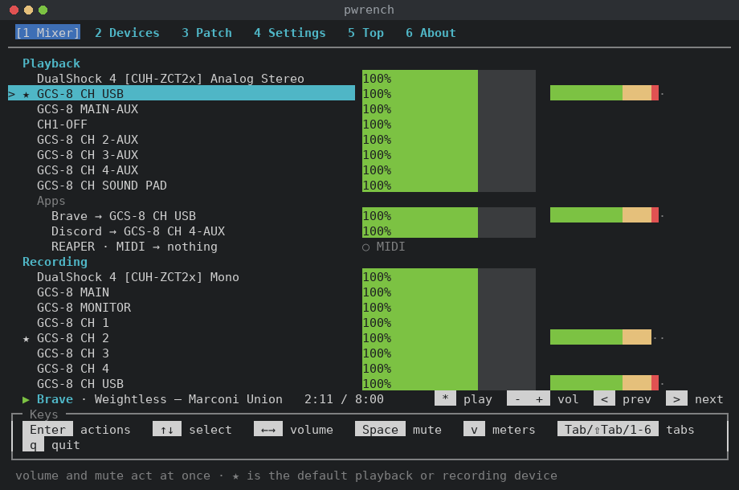

- **Tabs** along the top: Mixer, Devices, Patch, Settings, Top, About. Switch with `Tab` (`Shift+Tab`
  goes back), the number keys `1`–`6`, or a click. Leaving a tab resets it: open menus close and
  unapplied Settings changes are dropped, so a tab always opens clean.
- **The status line** at the very bottom, on its own colour bar, explains the selected row: what it is, then
  what you can do with it. `Enter:` lists what Enter offers there, read off the row's own menu.
- **The keys box** lists only the keys you can't guess: the view's letter shortcuts, `Esc` where
  it goes back, `Space` (mute) on the Mixer, and `q` to quit. The arrows, Enter, Tab and the number keys
  aren't listed: they always work, and the numbers are on the tabs. Each key is a chip, and clicking one
  presses it. Settings → Preferences → **Keys box** hides it; the keys still work.
- **Tap or click a row** to select it; tap or click it again (or double-click) to press Enter on it. That's
  how a touchscreen opens a menu, edits a value or connects a pair.
- **The status band** takes the status line's place to show what just happened: `✓` on green when it
  worked, `✖` on red when it didn't. It stays until you move (an arrow, Tab, a number key, paging or the
  wheel); then the selected row's note is back.
- **Questions and warnings** open in a box over the screen and stay until you answer: ←→ pick a
  button, Enter chooses it, Esc cancels. Other keys do nothing while it's open. A click or tap on a
  button works too. The cursor starts on Cancel, so a stray Enter never does the risky thing.
- **The now-playing box**, between the keys box and the status line, shows the media player that's playing: `*` play/pause,
  `-` `+` its volume, `<` `>` previous and next. There's no stop on purpose (Brave can't restart a
  stopped tab from outside).
- **The mouse wheel scrolls** whatever list you're in, wherever the pointer is. It never changes a
  value, so scrolling a long list is safe.
- `q` quits from anywhere, after asking (Cancel is preselected).
- **Letter keys are shortcuts.** Everything they do also has an arrow + Enter path, given in each table.

Menus open with Enter and close with Esc (or any other key). Anything that moves audio for every app,
like changing the default device, goes through a menu so a stray key can't do it.

## Mixer: everyday levels

Two boxes, **Playback** and **Recording**: every output or input, then the apps playing or recording under
an **Apps** heading. ★ marks the system default.

| Key | Does |
|---|---|
| ↑ ↓ | select a channel |
| ← → | volume −5% / +5%. → stops at 100% and asks before going louder (up to 150%) |
| mouse wheel | scroll the list (it never changes volume) |
| Space | mute or unmute |
| Enter (or tap the selected row) | the channel's menu |
| v (shortcut) | live meters on or off; or Settings → Preferences → Meters |

The volume % sits inside the bar. Green is up to 100%, red past it, grey when muted. Past 100% can clip, so
at 100% → opens a box: **Go louder** unlocks that channel until it's back under 100%, **Don't ask again**
unlocks it for good, and **Cancel** (where the cursor starts) leaves it. The channel menu's **Volume boost**
row locks or unlocks it any time.

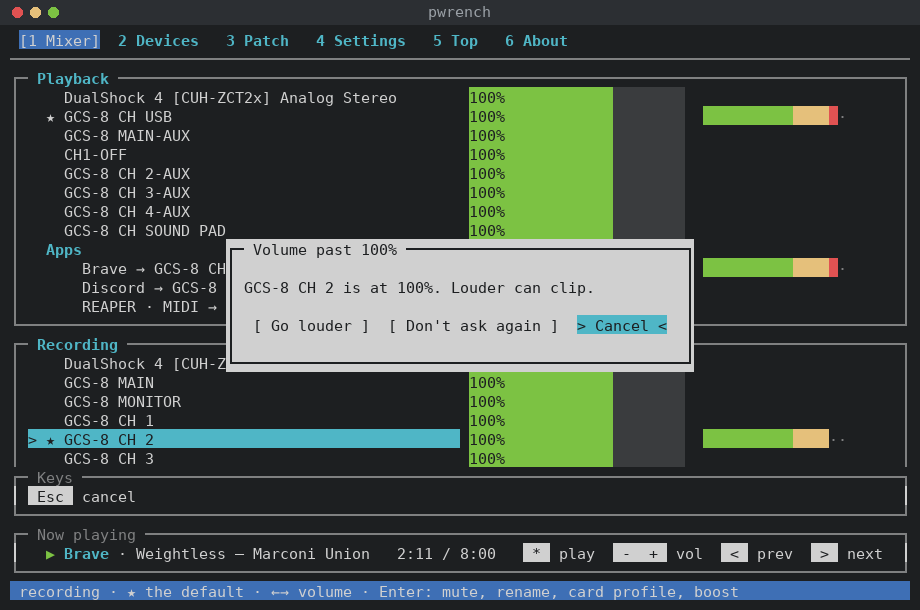
The media bar's `+` stops at 100%. On the command line, `pwrench devices volume DEV +5%` goes up to 150%. The meter to the
right shows the live level of running channels (yellow past −18 dB, red past −6 dB) with a short peak
hold.

An app with MIDI (REAPER) gets a second row for it, `REAPER · MIDI`, under its audio row: where its
MIDI goes (`→ KB16-01 MIDI 1, nanoKONTROL2 _ CTRL`) or comes from (`←`). Where the volume would be, a
dot lights (● MIDI) as MIDI passes and goes dim (○ MIDI) when it stops. The dot works while meters
are on (`v`).

**Prefer numbers?** Settings → Display → Volume bar off leaves just the %, and the meter moves in
beside it:

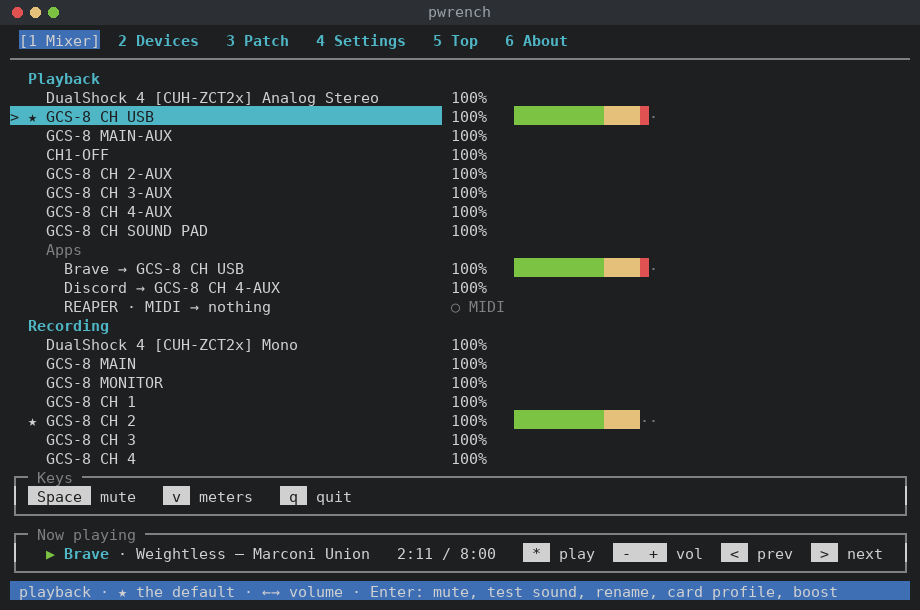

### The channel menu

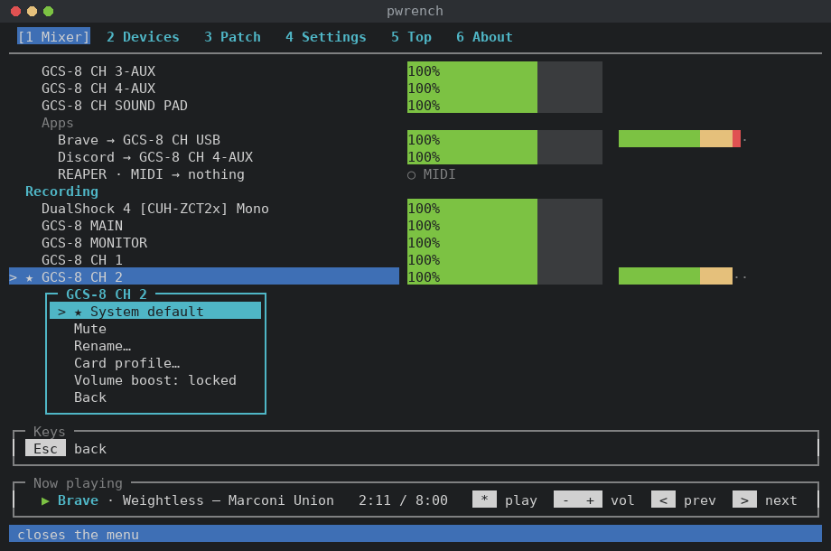

- **Set as system default:** every app that follows the default moves to this channel. It's first in
  the menu, so Enter, Enter does it.
- **Mute** / **Test sound** (outputs play a short noise burst).
- **Rename…** gives the channel your own name, say "Mic" for GCS-8 CH 2. An empty name puts the
  original back.
- **Card profile…** jumps to the channel's sound card on Devices with its profiles open.
- **Volume boost: locked / unlocked** decides whether → can go past 100% without asking. Unlocked is
  remembered for that channel (apps too). Locked is the default.

Renaming asks one more question:


WirePlumber reads names when it starts, so a new name shows after a WirePlumber restart.
PipeWrench asks "Restart WirePlumber now to show it?" Pick Cancel if you're on a call: a restart drops
apps like Discord, and some don't reconnect on their own. The name is saved either way and appears at
the next restart or login.

## Devices: hardware and buses

A box per sound card: its **Profile** first, then its channels, each with its direction, status, volume and
node number. Every line can be selected, and the status line says what it is. Channels only show
something: Enter does nothing on them, because channel work (default, rename, test, levels) is on the Mixer.
Then **MIDI**, **Buses** and **Off**, each in its own box.

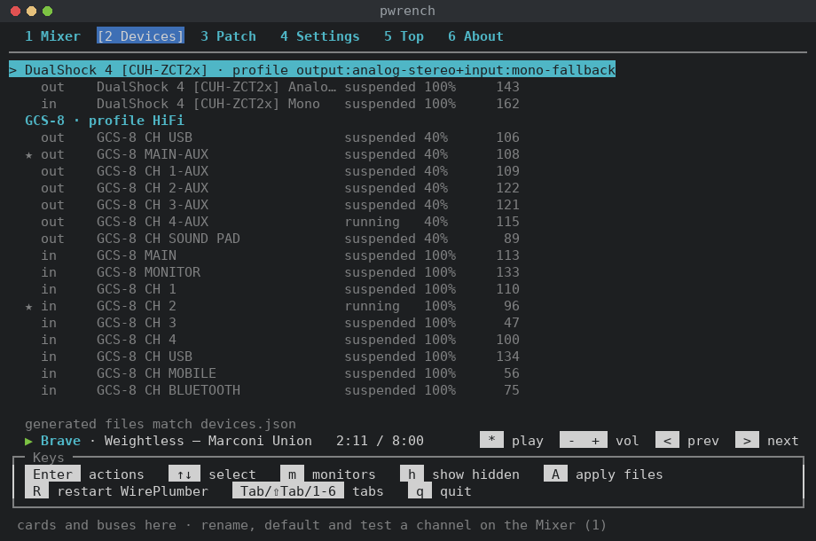

| Key | Does |
|---|---|
| Enter | the card's menu (on its Profile line) or the bus's menu; nothing on a channel |

| Shortcut | Does | Without it |
|---|---|---|
| p | the card's profile menu | Enter on the card |
| h | show hidden cards and buses (dimmed) | Settings → Preferences → Show hidden devices |
| m | list each output's monitor | Settings → Preferences → Monitors on Devices |
| a | add a bus | Enter on **+ Add bus…** |
| x | delete a bus (asks first) | Enter on the bus → Delete bus |
| t | test sound on a bus | Enter on the bus → Test noise |

**Everything here is saved as you go**, and survives closing PipeWrench, restarting WirePlumber and
rebooting: hidden devices, each card's profile (on or off), names, buses, and whether Show hidden and
Monitors are on. There's no Apply step. A name or a bus shows once WirePlumber restarts (PipeWrench asks
where that matters). If WirePlumber comes back with a card on the wrong profile, PipeWrench puts it back
when it starts; `pwrench devices restore` does the same from a login script.

Cards on profile `off` (unused HDMI, a webcam you don't use for sound) wait at the bottom, in the **Off** box.
Enter on one opens its profiles, to turn it on.

MIDI devices (a controller, the GCS-8's MIDI ports, a macro pad) are listed in the **MIDI** box, after the
cards. Each shows its ALSA card (`hw:3`) and what it's connected to (`← REAPER  → REAPER`); there's nothing to
set on one here. Connect them on Patch.

### Switch a card's profile

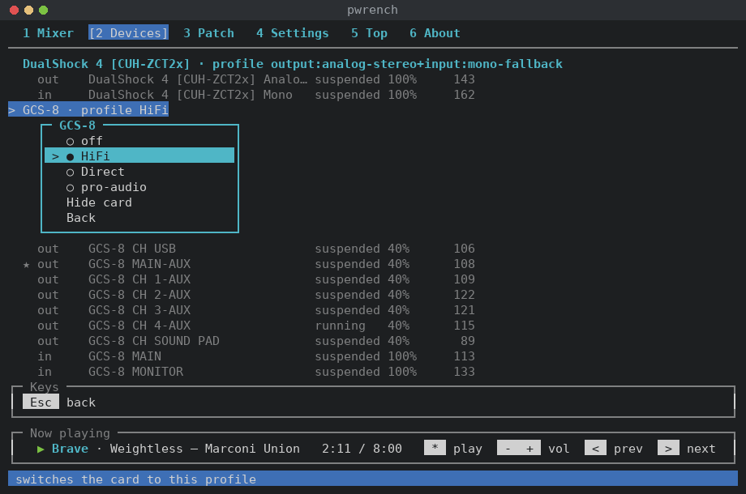

● marks the active profile. Picking another asks first, because audio on that card drops for a
moment. For the GCS-8, **HiFi** is the split profile (one channel pair per device). Picking `off`
turns the card off completely. The choice is saved and comes back after a restart.

### Hide a device you never use

Select its card and press Enter → Hide card (there's no shortcut, so a stray key can't hide a card). Hidden cards leave the Mixer too. `h` shows
them again, dimmed, so you can unhide one. Most people want every channel; hiding is for whole
devices, like onboard audio you never plug into.

### Buses

A bus is a virtual device apps can play into or record from, for example a "Stream" bus that OBS
records and your music plays into. Press `a` (or Enter on **+ Add bus…**) and give it a name:

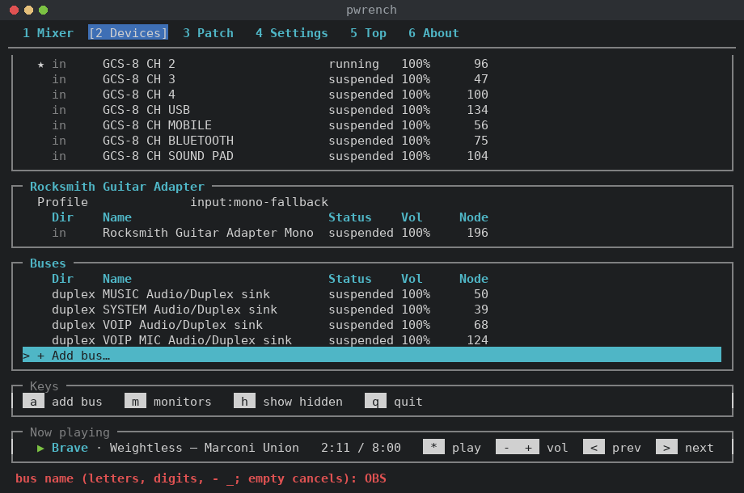

It's created at once, with no restart. A bus's own menu hides or deletes it:

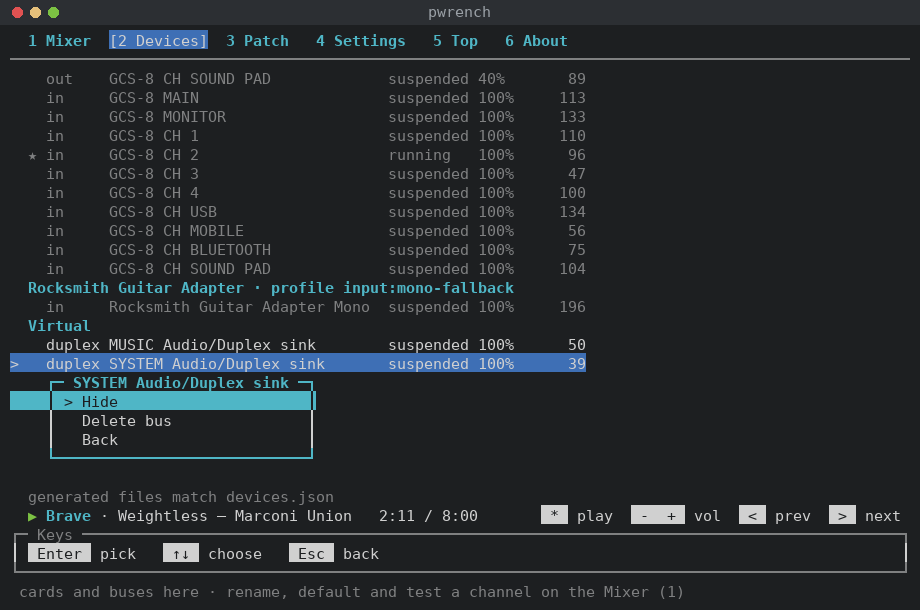

Name a bus on the Mixer like any channel; a bus shows its new name after the next login.

## Patch: what goes where

Two boxes side by side: **Sources** on the left (apps playing, inputs, buses), **Destinations** on the right
(apps recording, outputs, buses). MIDI has its own pair below, **MIDI sources** and **MIDI destinations**. Select
a source, then `→` into the destinations and press Enter to connect or disconnect. The page scrolls to keep the
cursor in view.

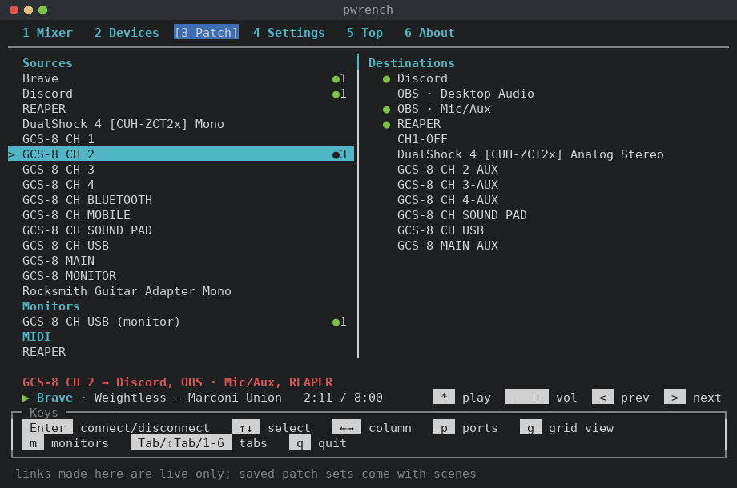

- ● next to a destination: the selected source goes there. `●3` next to a source: it feeds three
  destinations.
- The status line says how many links the selected source has, or the selected pair's state.
- Connecting pairs channels up (FL→FL, FR→FR). A mono source feeds both.
- Links made here are live. PipeWire may not keep them after a restart; saved patch sets are planned
  with scenes.

| Key | Does |
|---|---|
| ↑ ↓ | select |
| ← → | switch between sources and destinations |
| Enter | connect or disconnect |

These three are shortcuts only, and always in Patch's keys box:

| Shortcut | Does |
|---|---|
| g | grid view (`g` again for columns) |
| p | port matrix for the selected pair |
| m | show every monitor |

### Monitors (OBS desktop audio)

A **monitor** is a copy of what an output is playing. OBS's Desktop Audio records an output's monitor,
not the output itself. Monitors that something records from always show, under their own heading;
`m` adds the rest.

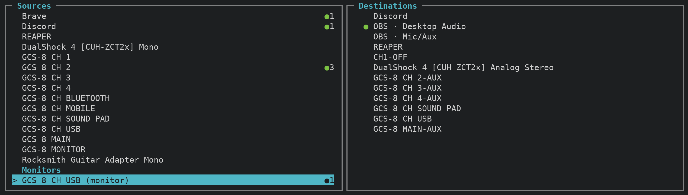

So if OBS is set to GCS-8 CH USB but the CH USB input looks unconnected, look under **Monitors**:
`GCS-8 CH USB (monitor) ●1` is the one OBS takes.

App streams carry their own names when they give one: OBS's inputs read `OBS · Desktop Audio`,
`OBS · Mic/Aux`.

### MIDI

MIDI ports are in the MIDI pair of boxes, under the audio: controllers and
interfaces by their port name (`nanoKONTROL2 _ CTRL`, `GCS-8 MIDI 1`), and apps like REAPER by name.
Connect them the same way, with Enter. MIDI only connects to MIDI; Enter on an audio destination says
so and changes nothing.

From the command line, a MIDI source picks the app's MIDI input:
`pwrench patch connect "nanoKONTROL2 _ CTRL" REAPER`.

### Grid view

`g` shows sources against destinations: ● connected, ◐ one channel only, · not connected. Audio and MIDI are
separate boxes, each with its own kind of destination across the top, and ←→ stay on that kind. The numbers
are the destinations in the **Destinations** box, which stays at the bottom so the numbers always have their key.

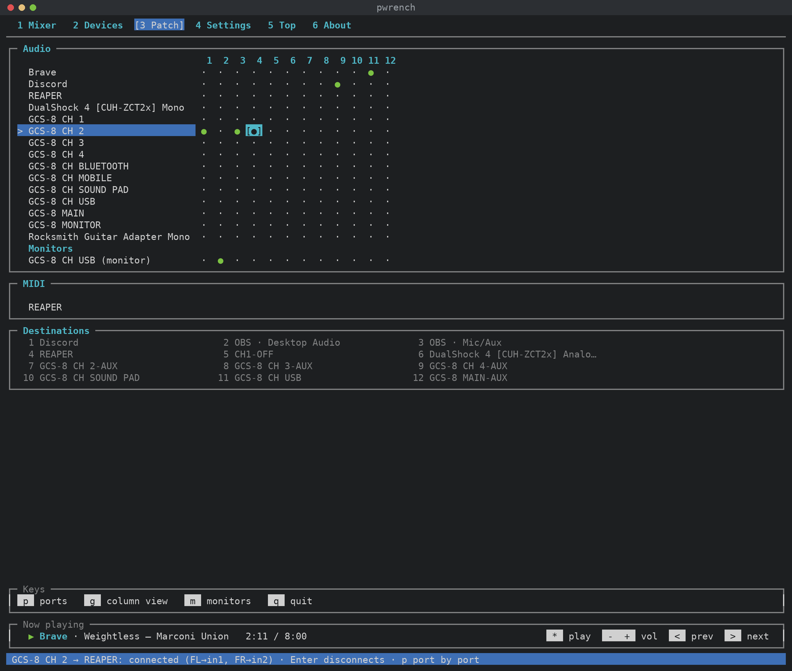

### Recording into REAPER's inputs

REAPER (through `pw-jack`) shows its inputs as plain in1, in2… Enter on REAPER as a destination
opens a slot menu, starting at the next free pair:

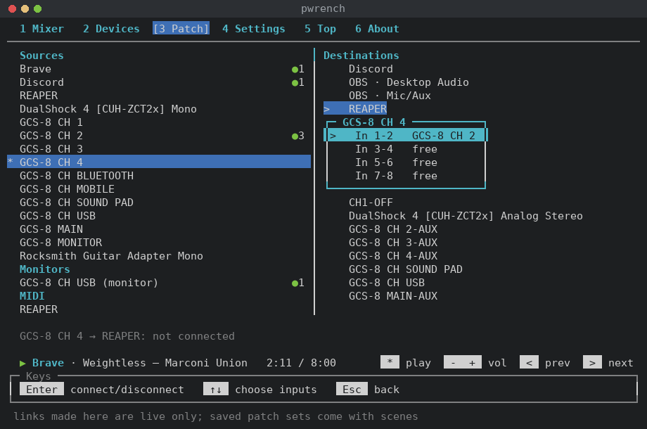

Pick **In 3-4** and the selected source records into REAPER's inputs 3 and 4.

### Port by port

`p` opens a port matrix for the selected pair, in a box titled with the pair, for patches like CH 2's left
channel into REAPER in3 only. Enter links or unlinks the port under the cursor.

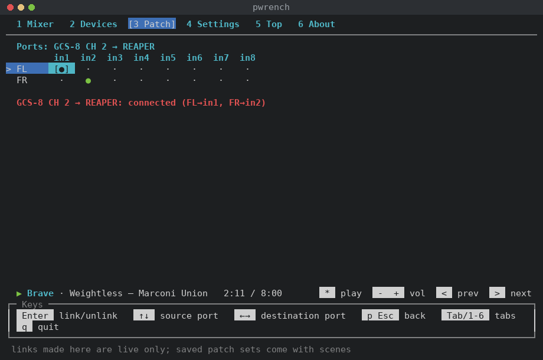

## Settings

A menu on the left picks the category, and the category opens on the right. Settings opens on the
menu: ↑↓ picks **Audio**, **Network** or **Preferences**, and Enter or → goes into it. ← or Esc comes back to the
menu, and coming back drops any unapplied change. A click on a category opens it.

A value never changes on a stray arrow: **Enter opens a row**, then ←→ change it. A row's `◀ ▶` stay grey until it's open. Enter applies (or keeps)
it, Esc puts the row back, and ↑↓ close it, keeping the change. A tap on a row's ◀ ▶ opens it and steps it
in one go.

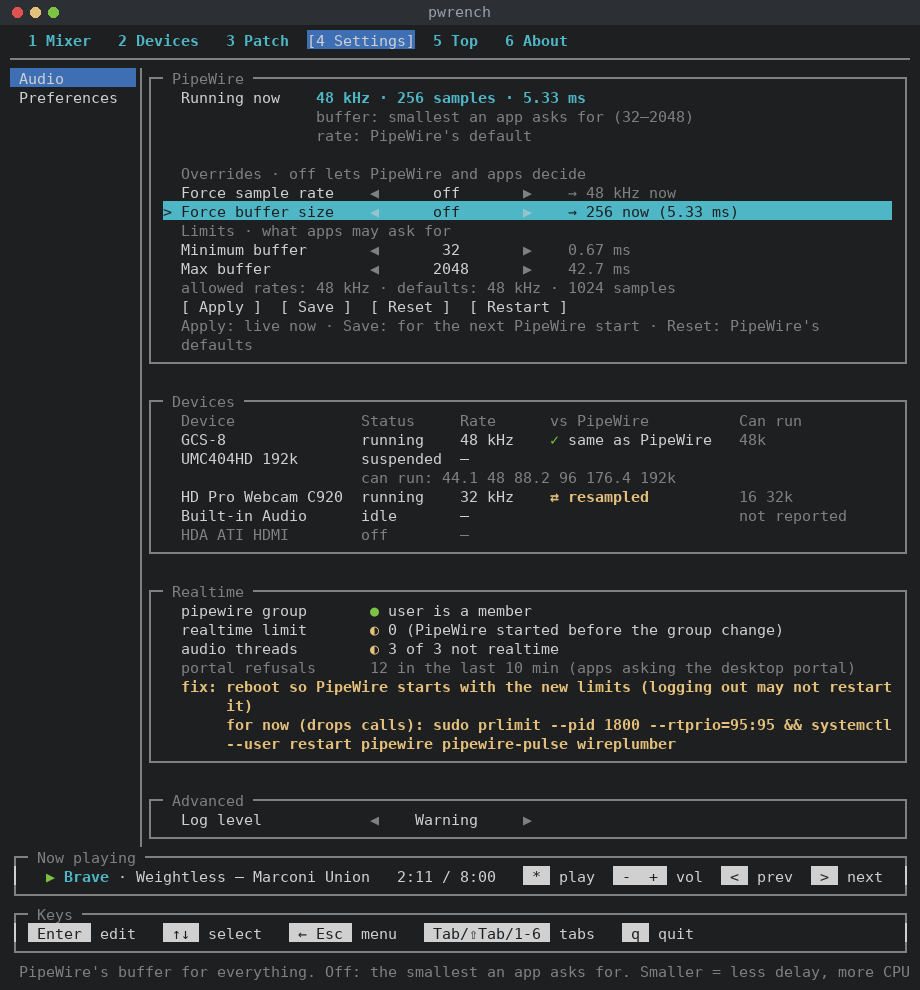

### Audio

PipeWire is a server: every app and every sound card goes through it. The page follows that order in
four boxes: **PipeWire** (the server), **Devices** (the cards it manages), **Clock** (what you can change)
and **Advanced**. Each line names a thing, then gives its status. ↑↓ visits every line, and the status
line at the bottom says what the selected one means. Lines that only show something don't open; Enter
does nothing there.

**How it fits together.** PipeWire is the mix: every app and every device meets in one clock, with one
sample rate and one buffer size. Each device then runs at its own hardware rate. When a device's rate
matches PipeWire's, audio passes straight through. When it doesn't, PipeWire resamples between them, which
costs a little CPU and is usually inaudible.

#### PipeWire

- **Server:** `● running`, or `✖ not answering` when PipeWire has stopped responding.
- **Realtime:** whether PipeWire's audio runs with realtime priority (`● realtime` or `◐ not realtime`).
  Without it, anything else on the computer can interrupt the audio, and you hear stutters and dropouts,
  for example on a Discord call. Its checks sit under it:
  - **pipewire group:** realtime is granted to members of the `pipewire` group.
  - **realtime limit:** what PipeWire actually got. 0 means it started without the permission.
  - **audio threads:** each of PipeWire's audio threads, realtime or not.
  - **portal refusals:** for information. Apps ask the desktop portal for realtime too, and it refuses
    them; that's harmless once PipeWire itself is realtime.
  - **fix** and **for now:** when realtime isn't working, what to run in a terminal. PipeWrench never
    runs `sudo` itself. "For now" restarts PipeWire, which drops calls.

  The usual fix is `sudo usermod -aG pipewire $USER` and then a **reboot**. Logging out isn't always
  enough, because the session that starts PipeWire can stay running.
- **Running now:** what PipeWire is doing this moment, read live, for example `48 kHz · 256 samples ·
  5.33 ms`. With nothing playing it says **idle**, and what applies when something starts. If two devices
  run on separate clocks at different settings, each gets its own line, named. Under it, where each value
  comes from:
  - **buffer set by:** *forced*, or *the smallest an app asks for* (Discord, the browser and REAPER each
    ask), kept between Minimum and Max buffer;
  - **rate set by:** *forced*, *PipeWire's default*, or *an app asked for it* (only rates in **Allowed
    rates**).

When realtime is right, the Realtime line and its checks are green and there's no fix:

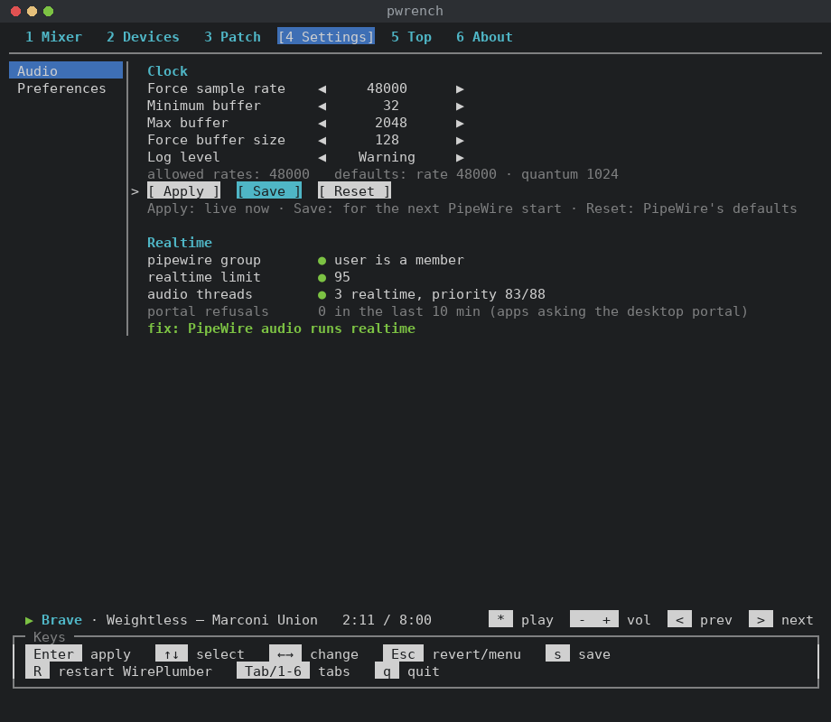

`pwrench realtime` prints the same check in a terminal and exits 0 when all is well.

#### Devices

Every sound card, on or off, one line each:

- **Status:** running, idle, suspended (asleep until something uses it), or off (its profile is off).
- **Rate:** the rate it's running at.
- **vs PipeWire:** `✓ same as PipeWire`, or `⇄ resampled` when its rate differs from PipeWire's.

Select a card and the status line says what that means for it and which rates it can run, as the kernel
lists them. USB interfaces report rates, and so do onboard and HDMI cards (Intel HDA: only the rates every part
of the chip lists); others say `not reported`. A device that plays and records
at different rates shows each (`out 32k · in 16k`).

#### Clock

**Force sample rate** and **Force buffer size** override PipeWire. **off** lets PipeWire and the apps
decide, and the row shows what's running instead (`off → 256 now (5.33 ms)`; `→ waiting for pw-top`
until the live reading arrives). Set one to make it win over every app: 128 or lower for tracking, 1024
for mixing.

**Minimum buffer** and **Max buffer** are the range apps may ask for. Each row shows its latency at the
rate in use: one buffer's period, buffer ÷ rate (128 at 48k is 2.67 ms; at 192k, 0.67 ms). It's not the
round trip, which adds each device's own buffers.

**Allowed rates** are the rates an app may switch PipeWire to, and **Defaults** are PipeWire's own rate and
buffer when nothing forces them. Both come from PipeWire's config and only show here.

An open row's change is marked `*` until applied. When you change the rate:

- a card that can't run it is named (`GCS-8 can't run at 192k (it supports 48k)`);
- a rate outside **Allowed rates** runs PipeWire at that rate while your devices stay at the default
  rate and PipeWire resamples, and the warning says so;
- if any card that's on doesn't report its rates: "Make sure your device(s) support the rate selected."

Four buttons end the box. ↓ to their row, ←→ picks one, and Enter or a click presses it:

- **Apply** sets the changes live, now. Enter on an open row does the same, and Esc reverts.
- **Save** keeps the live clock for the next time PipeWire starts. It writes to PipeWrench's PipeWire file, `~/.config/pipewire/pipewire.conf.d/50-pipewrench-devices.conf`,
  and never restarts anything. A forced rate or buffer is saved as PipeWire's default, so apps can still
  ask for another size after a restart. Values that aren't forced, or match PipeWire's own defaults,
  aren't written. Apply any changes before saving.
- **Reset** loads PipeWire's defaults (no forced rate or buffer, min 32, max 2048) as changes marked
  `*`. Apply sets them live, and Save after that clears the saved clock.
- **Restart** restarts WirePlumber, after asking. It's the one place to do it: no shortcut, so a stray key
  can't drop your audio. Apps like Discord may
  lose their audio, so pick Cancel if you're on a call.

#### Advanced

**Log level**: how much PipeWire writes to its log (the system journal), from No log through Error,
Warning, Info and Debug to Trace. It never changes the sound. Raise it only to chase a bug, then put it
back to Warning: the high levels cost CPU and fill the journal fast. Enter opens it, ←→ picks, Enter
applies.

### Network

Audio and MIDI to and from other machines on your network, over **VBAN**: an open protocol that
Voicemeeter, VBAN apps and PipeWire all speak. PipeWire has it built in, so there's nothing to install.
Each stream runs on its own, so adding, changing or turning one off never restarts PipeWire, and the ones
that are on come back at login.

The page has three boxes:

- **This machine**: the address other machines send to, and which PipeWire you have.
- **Incoming streams**: audio or MIDI arriving from another machine. Each shows where it comes from, the
  port it listens on, where it plays (`→ GCS-8 CH USB`, or `not connected`) and its format.
- **Outgoing streams**: what this machine sends. Each is also an output device: it shows in the Mixer and
  in your system sound settings, so an app can play straight to it. It never becomes the default.

`●` is on, `○` off. A stream that isn't running says why: `off`, `stopped` or `failed`.

**Add a stream.** Enter on **+ Add stream…** in either box, then pick:

- **Detect on network**: on Incoming it listens for 2 seconds and lists what's arriving first ("Studio ·
  192.168.1.86 · 48 kHz · 2 ch"; pick one and its name, address and format are filled in), then the
  computers the network search finds (pick one and set Format… to match its sender). The search covers
  the times listening can't: PipeWire before 1.4.2 holds port 6980 once you have an incoming stream, and a
  sender that isn't sending yet can't be heard. On Outgoing it searches your network for computers (about 5 seconds) and lists each by name and address, named by your
  router, with ones already sending VBAN first ("studio-pc · 192.168.1.86 · sends VBAN"). Phones, TVs,
  cameras and the router are left out. It never shows what a machine runs, only that it's there.
  The search uses `nmap` when it's installed (`sudo apt install nmap`); without it it still finds the
  machines this one has talked to lately.
- **Manual**: type the device's name, then its IP address.

An outgoing stream goes out under this machine's name, so Detect on the other end names it after you.

Then a short list asks where it goes: **Select Playback Destination** for an incoming stream (a device, a
bus or an app's input), **Select Source Audio** for an outgoing one (an input, a monitor of an output, or
an app). **Not connected** leaves it for the Patch tab.

**Enter on a stream**: Turn off / Turn on, Playback destination… (or Source audio…), Format…, Rename…,
Remove (it asks first). Format… has the common ones (48 kHz 16-bit stereo, which Voicemeeter uses, mono, 44.1 kHz,
24-bit, 32-bit float) and MIDI.

**Things to know**

- **Both ends must use the same format.** PipeWire doesn't convert what arrives: a mono sender into a
  stereo stream sounds wrong. Detect fills it in for you; with Manual, check Format… against the sender.
- **PipeWire before 1.4.2** (Linux Mint 22 has 1.0.5) takes one incoming stream per port, so each incoming
  stream gets its own port: 6980, then 6981 and so on. The status line says what to point the sender at
  ("sends to 192.168.1.99:6981"). From 1.4.2 they all share 6980 and PipeWrench tells senders apart by
  their address. Outgoing works the same way round: a second stream to the same machine goes to 6981, a
  third to 6982, so a receiver before 1.4.2 can take each one. Streams to different machines all use 6980.
- **An incoming stream plays where you picked every time it starts**, even with PipeWrench closed. An
  outgoing stream's source, and MIDI, are linked by PipeWrench: if the source goes away and comes back (an
  app restarts), PipeWrench links it again within a few seconds while it's open, or the next time it starts.
- **Picking an app as an outgoing source moves it there:** the app plays to the stream instead of its own
  output. To send what's playing *and* keep hearing it, pick the output's monitor ("UMC404HD 192k Pro
  (monitor)").
- **Detect needs port 6980 free.** While an incoming stream listens there it can't, and says so; Manual
  still works.
- **A firewall can block it.** VBAN uses UDP port 6980 (and up, before 1.4.2). If Detect hears nothing,
  check the receiving machine's firewall.
- VBAN isn't encrypted. Use it on your own network.

Files: `~/.config/pipewrench/vban.json` (your streams), `~/.config/pipewrench/vban/*.conf` (one per
running stream) and `~/.config/systemd/user/pipewrench-vban@.service`. PipeWrench made them and keeps them
in step; edit streams here, not there.

### Preferences

PipeWrench's own settings. Open a row with Enter; ←→ then change it live (a theme shows at once), Enter
keeps it and Esc puts it back. They're kept in `~/.config/pipewrench/ui.json`.

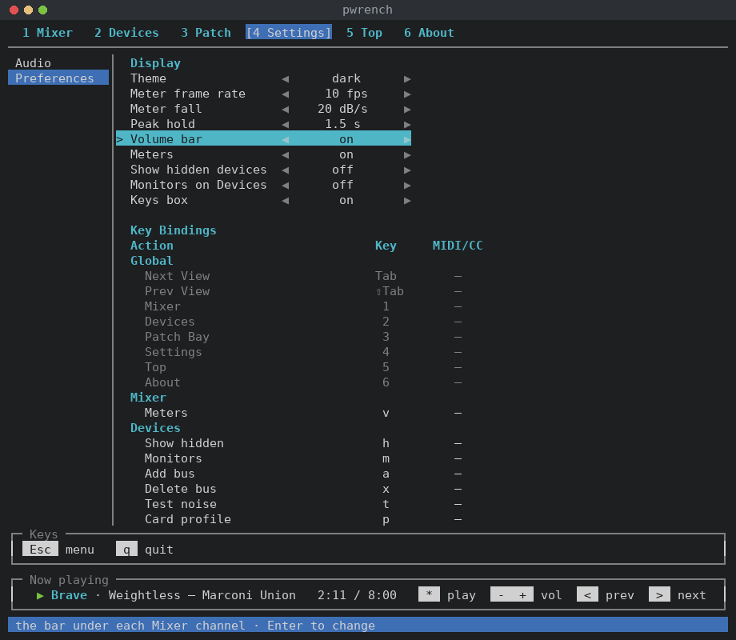

Preferences has two boxes, **Display** and **Key Bindings**.

#### Display

Theme (dark, light, crowbar orange, Pipe Boy in green, amber, cyan or white, Vaporware, Pipecraft, or
pipeOS-lite and pipeOS-dark), the meters' frame rate, fall speed and peak hold, the
Mixer's volume bar, **Meters** (the Mixer's live levels, what `v` toggles), **Show hidden devices** and
**Monitors on Devices** (what `h` and `m` toggle on Devices) and **Keys box**. The status line at
the bottom says what the selected row does. With the
Keys box off, the key list at the bottom of the screen is gone and the view gets those lines. Every key,
letter shortcuts included, still works.

**Pipe Boy** is one phosphor colour, after Fallout's Pip-Boy: green, amber, cyan or white. With no other
colours, status shows by style: good is bold, waiting is underlined, and a problem is a pale block.

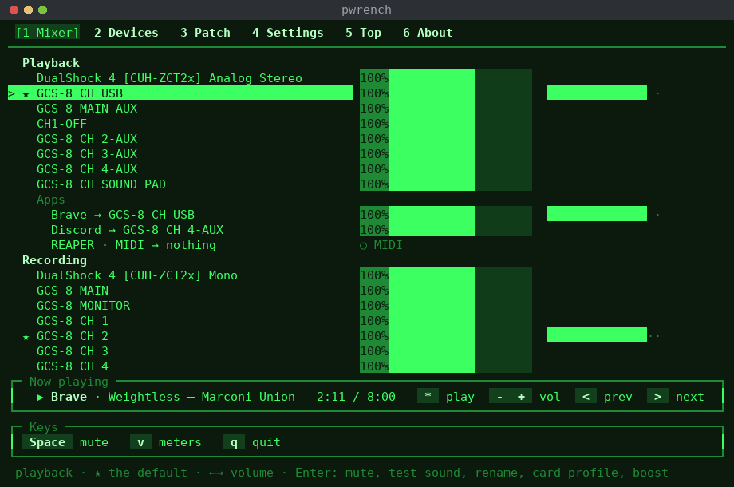

**Vaporware** is pink, cyan and mint on dark purple.

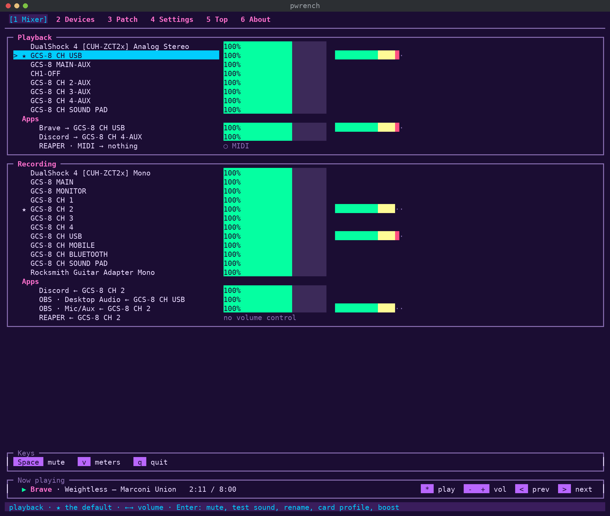

**Pipecraft** uses Minecraft's text colours on dark dirt, and its About tab says PIPECRAFT.

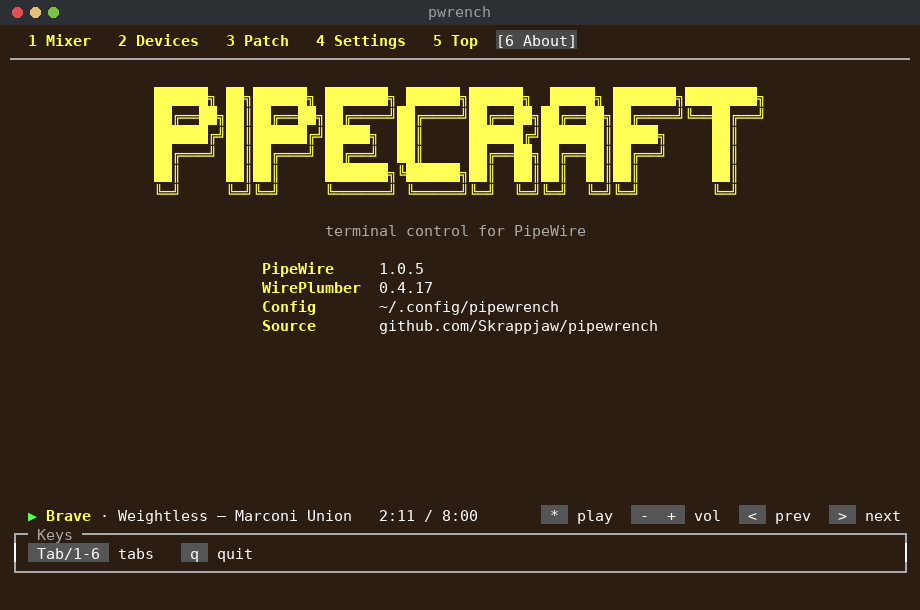

**pipeOS-lite** (a clean test chamber) and **pipeOS-dark** (Portal 2's moody chambers) follow one rule:
anything with a direction is a portal colour, blue for playback, outputs and sources and orange for
recording, inputs and destinations. Everything else uses blue.

- **Patch:** blue dots and cursor bar on the sources, orange on the destinations. The slot menu is orange.
- **Mixer:** Playback's heading, cursor bar and menu are blue; Recording's are orange. Volume bars are
  panel grey, and the level meters run blue, orange, then red.
- **Devices:** each channel's `out` is blue and `in` orange.
- **Everything else:** the cursor bar, tabs, titles, key chips and the Settings menu are blue.
- **Status dots stay plain.** Realtime's dots, and the ● and ○ marking a card's profile, show their status in
  white, yellow or red, never a portal colour. There's no green anywhere.

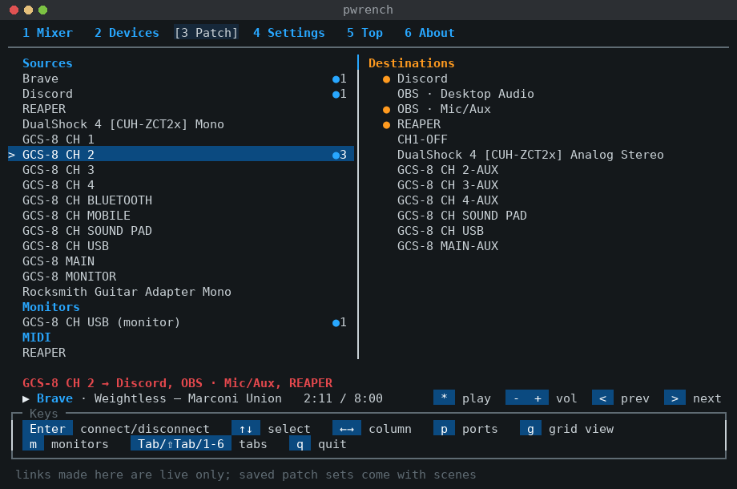

Every theme except dark and light needs a 256-colour terminal; on a basic one PipeWrench shows dark instead.

**Your own themes.** Every theme is a small TOML file you can copy and change: `pwrench theme export
pipeos-dark`, edit a line, then open the Theme row again to pick it. Opening the row re-reads the files, and the
status band says how many it found or what's wrong with one. Everything is in **[the theme guide](themes.md)**.

#### Key Bindings

Every key, in columns **Action · Key · MIDI/CC**, under a heading for each view: **Global**, **Mixer**,
**Devices** and **Patch Bay**.

- **Global** keys are fixed: Tab and ⇧Tab for the next and previous view, `1`–`6` for each view. They're
  listed so a MIDI/CC control can be set beside them later.
- On a view's row, Enter, then press the new key. Backspace (or Delete) takes the key off, so the
  shortcut does nothing; Esc cancels. `*` marks a changed key. **Reset all keys** puts every shortcut back
  after asking.
- The **MIDI/CC** column shows `—` for now: MIDI control is coming.

- A key that's taken on the same screen, or one that works everywhere (`q`, `1`–`6`, the media keys
  `* - + < >`), is refused and the reason shows on the status line.
- A clash that's already in the file, from hand editing, shows red with the reason. The first shortcut
  on that screen keeps the key.
- Arrows, Enter, Esc, Space and Tab can't be rebound.
- The key legend at the bottom of each tab shows your keys.

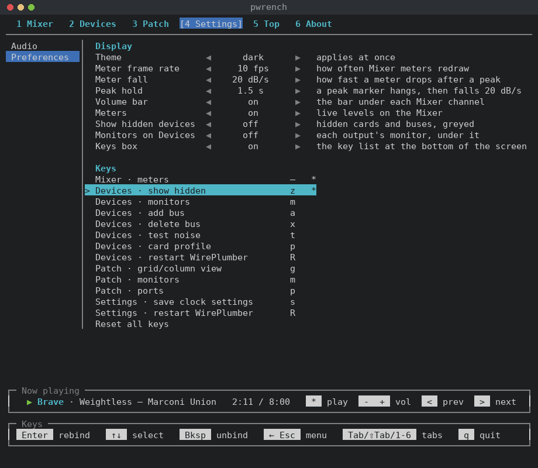

## Top

A live `pw-top`: every node's quantum, rate, timing and errors (ERR). A box per driver (the device that
sets a clock), titled with its buffer and rate, holds the nodes that follow it; drivers with nothing
running wait in **Idle**. Rows with errors show red. Every row can be selected (↑↓, PgUp/PgDn ten at a time),
and the status line says what it is: a driver and how many follow it, or what a follower follows, with its
dropout count. Enter does nothing here: Top only shows.

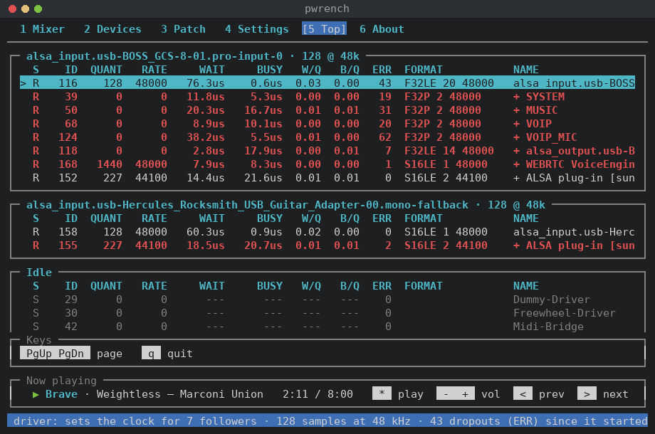

## About

The versions of PipeWire and WirePlumber, and where PipeWrench keeps its settings. The logo changes with
the theme: dark and light show the PipeWrench wrench, and Crowbar, the Pipe Boys and Vaporware each
have their own lettering.

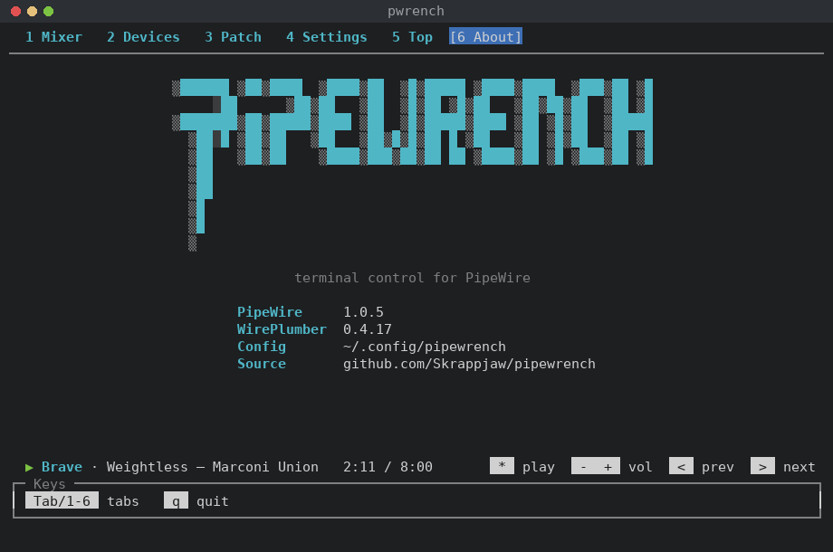

## Command line

Everything below works without opening the screen, for scripts and quick changes. `pwrench -h` (or
`--help`, `help`) prints the short version.

**General**

| Command | Does |
|---|---|
| `pwrench` | the screen (keyboard and mouse) |
| `pwrench status` | the clock settings, allowed rates, defaults and each card's rates |
| `pwrench realtime` | whether PipeWire's audio runs realtime, and the fix if not; exits 0 when it does, 1 when it doesn't |
| `pwrench top` | runs `pw-top` |

**Clock** (live, like Settings → Audio → Clock; nothing restarts)

| Command | Does |
|---|---|
| `pwrench rate N` | force the sample rate (`0` = off) |
| `pwrench buf N` | force the buffer size (`0` = off) |
| `pwrench min N` | the smallest buffer an app may ask for |
| `pwrench max N` | the largest buffer an app may ask for |
| `pwrench log N` | PipeWire's log level, `0` (no log) to `5` (trace) |
| `pwrench reset` | stop forcing the rate and the buffer |

**Devices** (`pwrench devices` alone is `list`)

| Command | Does |
|---|---|
| `devices list [--hidden] [--monitors]` | cards and channels; `--hidden` includes hidden ones, `--monitors` each output's monitor |
| `devices default DEV` | make it the system default |
| `devices volume DEV STEP` | change the volume, e.g. `+5%` or `-5%` (up to 150%) |
| `devices mute DEV` | mute or unmute |
| `devices test DEV` | play a test noise on it |
| `devices profile CARD PROFILE` | switch a card's profile (asks first) and save it |
| `devices restore` | put every card back on its saved profile (for a login script) |
| `devices label DEV TEXT` | give it a name |
| `devices label DEV --clear` | remove the name |
| `devices hide NAME` · `devices unhide NAME` | hide or show a card or channel |
| `devices bus add NAME [LABEL]` | add a bus |
| `devices bus delete NAME` | delete a bus |
| `devices preview` | show what `apply` would write |
| `devices apply [--restart]` | write PipeWrench's PipeWire and WirePlumber files; `--restart` also restarts WirePlumber |
| `devices rollback` | put the previous files back |
| `devices restart` | restart WirePlumber (apps may lose their audio for a moment) |

**Patch** (`pwrench patch` alone is `list`)

| Command | Does |
|---|---|
| `patch list` | every source and destination, and what's linked |
| `patch connect SRC DST` | connect them, channels paired (a MIDI source picks the app's MIDI input) |
| `patch disconnect SRC DST` | disconnect them |

**Network** (VBAN; `pwrench vban` alone is `list`)

| Command | Does |
|---|---|
| `vban list` | incoming and outgoing streams, where they go and whether they run |
| `vban detect [SECONDS]` | VBAN streams arriving on port 6980 (default 2 s) |
| `vban scan` | computers on this network to send to, as Outgoing's Detect lists them |
| `vban add in NAME IP [--to DST] [--midi]` | a stream from that machine, playing to DST (or not connected) |
| `vban add out NAME IP [--from SRC] [--midi]` | a stream to that machine, fed from SRC (or nothing yet) |
| `vban connect in\|out NAME NODE` | where an incoming stream plays, or what feeds an outgoing one |
| `vban disconnect in\|out NAME` | leave it not connected |
| `vban on\|off in\|out NAME` | start or stop it; it stays saved |
| `vban remove in\|out NAME` | stop it and forget it |

**Themes**

| Command | Does |
|---|---|
| `theme list` | the themes it found |
| `theme export ID [FILE]` | write a theme as TOML, to FILE or the terminal |
| `theme check [FILE]` | check theme files for mistakes |

DEV, CARD, SRC and DST take a device's name as `devices list` and `patch list` show it.

**Environment**

| Variable | Does |
|---|---|
| `XDG_CONFIG_HOME` | where PipeWrench keeps its settings (`…/pipewrench/`); default `~/.config` |
| `PIPEWRENCH_DEVICES` | use this file instead of `~/.config/pipewrench/devices.json` |
| `PIPEWRENCH_FIXTURES` | run on recorded test data instead of live PipeWire (for the tests) |

## When something's wrong

| Symptom | Look at |
|---|---|
| Stutter, dropouts, "robot voice" on calls | Settings → Audio → Realtime; Top's ERR column |
| Friends can't hear you | Mixer: is the right input ★ default, unmuted, with a moving meter? |
| Nothing arrives from another machine (VBAN) | Settings → Network: is the stream `●`? Is the sender pointed at this address *and port*, in the same format? Is UDP 6980 open in the firewall? |
| OBS isn't getting desktop audio | Patch → Monitors: is the output's monitor connected to OBS? |
| A device is missing from the Mixer | Devices: is its card hidden (H) or on profile `off`? |
| A new name doesn't show | It shows after a WirePlumber restart (Settings → Audio → Restart) or the next login |
| A red "PipeWire not answering" line under the tabs | PipeWire is up but hung. The screen keeps the last thing it saw and the keys still work; PipeWrench checks every 5 s and says "PipeWire is back" when it answers. It never restarts anything itself: `systemctl --user status pipewire wireplumber`, then restart them if you choose |

## Redrawing the pictures

```
python3 tools/screenshots.py
```

It draws every picture in `docs/guide/` from the test fixtures, so they stay in step with the UI. It
needs Pillow (`python3-pil`); PipeWrench itself doesn't.
