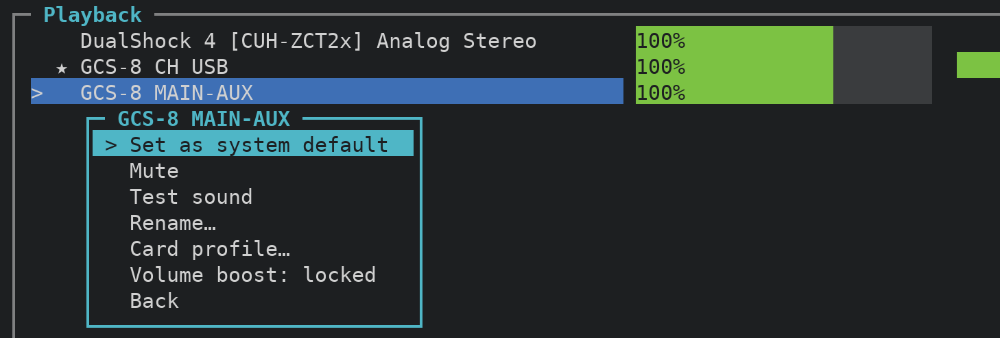
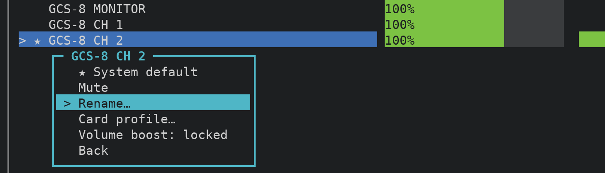
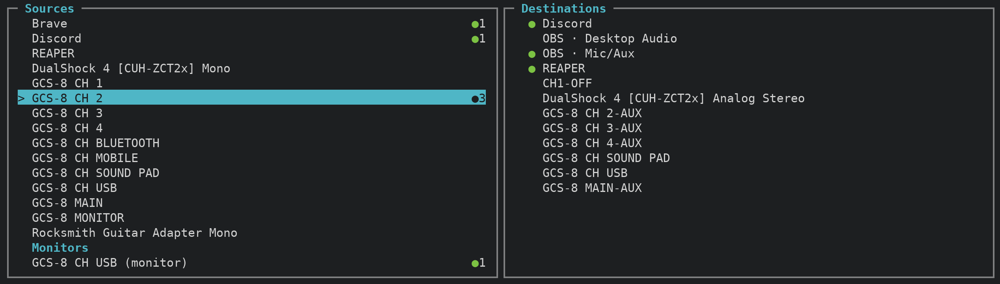
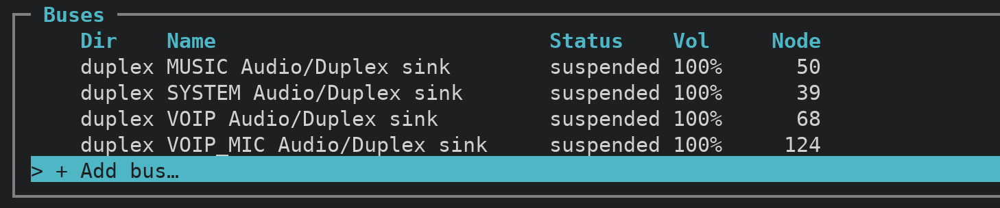
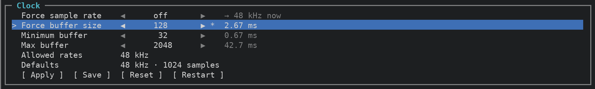
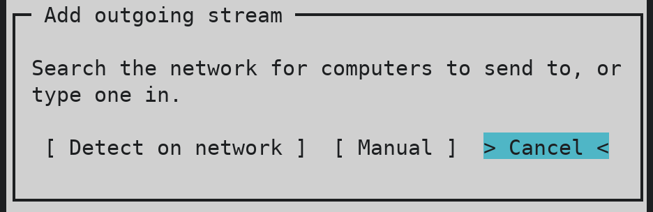

# PipeWrench user guide

This guide takes you from a fresh install to a working setup, and then serves as a reference for every
screen and command. If you're new, read [Getting started](#getting-started) and skim
[Common tasks](#common-tasks); after that, jump to whichever tab you're working in.

The pictures are drawn from recorded test data, so the device names you see belong to a BOSS GCS-8 and a
few apps. On your machine the same screens show your own devices.

**Contents**

- [Getting started](#getting-started)
- [Common tasks](#common-tasks)
- [Mixer](#mixer)
- [Devices](#devices)
- [Patch](#patch)
- [Settings](#settings): [Audio](#audio), [Network](#network), [Preferences](#preferences)
- [Top](#top)
- [About](#about)
- [Command line](#command-line)
- [Troubleshooting](#troubleshooting)

## Getting started

### Install and run

The [README](../README.md#install) has the three commands that install PipeWrench. Once it's linked into
`~/.local/bin`, start it from any terminal with:

```
pwrench
```

It opens on the Mixer, showing everything that's playing or recording right now. Nothing you do in
PipeWrench restarts PipeWire or WirePlumber unless you ask for it, so it's safe to open in the middle of a
call or a recording.

### A tour of the screen


The **tabs** along the top are Mixer, Devices, Patch, Settings, Top and About. You can move between them
with `Tab` and `Shift+Tab`, jump straight to one with the number keys `1` to `6`, or click a tab. Leaving a
tab resets it, so open menus close and any Settings change you haven't applied is dropped. A tab always
opens clean.

The **status line** runs along the very bottom of the screen on its own colored bar. It explains whatever
row is selected: first what the row is, then what you can do with it. When it says `Enter:`, it's listing
the choices that row's menu will offer. When you do something, the status line briefly becomes a **status
band**, green with a `✓` when it worked and red with a `✖` when it didn't. The band stays until you move,
and then the row's explanation comes back.

The **Keys box** lists only the keys you couldn't guess: the current tab's letter shortcuts, `Esc` where it
takes you back, `Space` on the Mixer, and `q` to quit. Each key is drawn as a chip, and clicking a chip
presses that key. The arrows, `Enter`, `Tab` and the number keys aren't listed, because they work
everywhere. If you'd rather have the space, Settings → Preferences → **Keys box** hides the box; the keys
keep working.

The **Now playing** box sits between the Keys box and the status line whenever a media player is playing.
`*` plays and pauses, `-` and `+` change the player's volume, and `<` and `>` skip back and forward. There's
no stop button, because some players, browsers in particular, can't restart a stopped tab from outside.

**Menus** open with `Enter` and close with `Esc`. Anything that affects every app at once, like changing the
system default, sits behind a menu, so a stray key can't do it. **Questions and warnings** open in a box
over the screen and wait for an answer: `←` and `→` choose a button and `Enter` presses it. The cursor
always starts on Cancel, so pressing `Enter` by accident never does the risky thing. `q` quits from
anywhere, and it asks first too.

The **mouse** works throughout. Click a row to select it, and click it again (or double-click) to press
`Enter` on it. That also makes PipeWrench usable on a touchscreen. The mouse wheel scrolls whatever list
the pointer is over and never changes a value, so scrolling through a long list is always safe.

**Letter keys are shortcuts.** Everything a letter does can also be reached with the arrows and `Enter`,
and each tab's table below gives both routes.

### Words this guide uses

- A **card** is a piece of sound hardware: a USB interface, the onboard audio, an HDMI output.
- A **device** (or **channel**) is one output or input that a card provides. A multi-channel interface like
  the GCS-8 can provide many, such as "GCS-8 CH 2" for a single mic input.
- An **app stream** is an app playing or recording: Discord's voice, a browser tab, OBS capturing a mic.
- The **default** output and input are where apps go when they haven't been told otherwise. PipeWrench
  marks them with ★.
- A **bus** is a virtual device you create. Apps can play into it and other apps can record from it,
  which makes it useful for building separate mixes.
- A **monitor** is a copy of whatever an output is playing. Recording apps use monitors to capture
  "desktop audio".

## Common tasks

Each of these takes a minute or two. The steps link into the reference if you want the details.

### Make your interface the default

Open the **Mixer** and use `↑` and `↓` to select your interface's output, for example "GCS-8 MAIN-AUX". Press
`Enter` to open its menu. **Set as system default** is the first item, so pressing `Enter` again makes it
the default, and every app that follows the default moves to it. (On a channel that's already the default,
that item reads ★ System default instead.)


Do the same in the Recording box for your
mic. The ★ moves to show the new defaults.

### Give your channels names that make sense

On a multi-channel interface the names PipeWire picks, like "GCS-8 CH 2", say little about what's plugged
in. Select the channel on the **Mixer**, press `Enter` and choose **Rename…**. Type a name such as "Mic"
and press `Enter`.



WirePlumber reads names when it starts, so PipeWrench offers to restart it so that the new name shows right
away. If you're on a call, choose Cancel: a restart can drop apps like Discord. Your name is saved either
way and appears at the next restart or login.

### Send your mic to two apps at once

Say you want your mic in both OBS and Discord. Go to **Patch** and select the mic in the **Sources** box.
Press `→` to move into **Destinations**, select `OBS · Mic/Aux` and press `Enter` to connect it. Then
select Discord and press `Enter` again. A ● next to each destination shows that the mic goes there, and the
number next to the mic counts its destinations: `●3` in the picture, where REAPER records it too.



### Put music on its own bus for a stream

On **Devices**, press `a` (or select **+ Add bus…** and press `Enter`) and name the bus "Music". It's
created immediately, with no restart.

 Then go to **Patch**, select your music player in **Sources**, and
connect it to the Music bus in **Destinations**. In OBS, add an audio capture of the Music bus. The music
now reaches the stream on its own fader, separate from your game and your mic, so you can balance them in
OBS. To keep hearing the music yourself, connect the Music bus's monitor to your headphones on Patch as well.

### Get desktop audio into OBS

OBS's Desktop Audio records the **monitor** of an output, not the output itself. On **Patch**, monitors
that something is already recording from appear under their own **Monitors** heading, and pressing `m`
shows all of them. If OBS is capturing the wrong thing, select the monitor of the output you listen on,
for example "GCS-8 CH USB (monitor)", and connect it to `OBS · Desktop Audio`.


### Record into REAPER's inputs

REAPER, running through PipeWire's JACK support, shows its inputs as plain numbered ports. On **Patch**,
select the source you want to record, press `→`, select REAPER and press `Enter`. A short menu offers its
input pairs, starting with the next free one. Pick **In 3-4**, for example, and the source records into
REAPER's inputs 3 and 4. For single channels, see [Port by port](#port-by-port).


### Lower your latency for recording

Open **Settings → Audio**. First check the **Realtime** line in the PipeWire box. If it doesn't say
`● realtime`, follow the fix it shows; without realtime, low buffer sizes will crackle no matter what else
you do.

Then go down to the **Clock** box, select **Force buffer size**, press `Enter` to open the row, and use `←`
and `→` to pick 128. Press `Enter` to apply it live.

 The row shows the latency each buffer adds in
milliseconds; 128 samples at 48 kHz is 2.67 ms. Go lower if your machine keeps up without dropouts, and
back up to 1024 or so when you're mixing and latency no longer matters. **Save** keeps the setting for the
next time PipeWire starts.

### Send audio to another computer

Both machines need PipeWrench, or any VBAN app on the other end. Start on the machine that **sends**. Open
**Settings → Network**, select **+ Add stream…** in the Outgoing box and choose **Detect on network**.

 Pick
the receiving computer from the list, then pick the source to send, such as your mic or the monitor of the
output you listen on.

Then go to the machine that **receives**, open the same page, and add a stream in the Incoming box with
**Detect on network**. The sender now appears at the top of the list with its address and format filled
in. Pick it, then choose where the audio should play. The [Network](#network) section covers formats,
ports and what to check when nothing arrives.

## Mixer

The Mixer is where everyday levels live. It has two boxes, **Playback** and **Recording**. Each lists every
output or input on the system, then the apps playing or recording under an **Apps** heading. The ★ marks
the system default in each box.

| Key | Does |
|---|---|
| ↑ ↓ | select a channel |
| ← → | lower or raise the volume by 5% |
| Space | mute or unmute |
| Enter (or a click on the selected row) | open the channel's menu |
| mouse wheel | scroll the list; it never changes a volume |
| v (shortcut) | turn the live meters on or off; also Settings → Preferences → Meters |

The volume percentage sits inside each bar. The bar is green up to 100%, red past it, and grey when the
channel is muted. Going past 100% can clip, so when a channel reaches 100% and you press `→` again,
PipeWrench asks before going further:


**Go louder** unlocks that channel until it drops back under 100%. **Don't ask again** unlocks it for good,
and **Cancel**, where the cursor starts, leaves it at 100%. The channel menu's **Volume boost** item locks
or unlocks a channel at any time. The most any channel can go is 150%, which is also the limit for
`pwrench devices volume DEV +5%` on the command line. The Now playing box's `+` stops at 100%.

The meter to the right of each running channel shows its live level. It turns yellow past −18 dB and red
past −6 dB, and a short peak marker hangs at the highest recent level.

An app that uses MIDI, like REAPER, gets a second row under its audio row, `REAPER · MIDI`. It shows where
the app's MIDI goes (`→ nanoKONTROL2 _ CTRL`) or comes from (`←`). Where the volume would be, a dot lights
(● MIDI) while MIDI is passing and dims (○ MIDI) when it stops. The dot works while meters are on.

If you'd rather read numbers, Settings → Preferences → **Volume bar** off leaves just the percentage and
moves the meter in beside it:


### The channel menu


- **Set as system default** moves every app that follows the default to this channel. It's the first
  item, so `Enter`, `Enter` does it.
- **Mute** mutes or unmutes the channel, and **Test sound** plays a short burst of noise on an output so
  you can check where it comes out.
- **Rename…** gives the channel your own name. Leaving the name empty puts the original back.
- **Card profile…** jumps to the channel's card on Devices with its profiles open.
- **Volume boost: locked** or **unlocked** decides whether `→` can pass 100% without asking. Unlocked is
  remembered for that channel, apps included. Locked is the default.

Renaming asks one more question:


WirePlumber only reads names when it starts, so a new name appears after WirePlumber restarts. PipeWrench
asks "Restart WirePlumber now to show it?" If you're on a call, choose Cancel, because a restart drops apps
like Discord and some don't reconnect on their own. The name is saved either way and appears at the next
restart or login.

## Devices

Devices shows your sound hardware the way PipeWire sees it. Each card gets its own box, with its
**Profile** at the top and then every channel it provides, along with the channel's direction, status,
volume and node number. Below the cards come three more boxes: **MIDI**, **Buses** and **Off**.


Every line can be selected, and the status line explains it. Channel lines are there to inform you: work
on a channel, like setting it as default or renaming it, happens on the Mixer, so `Enter` does nothing
here.

| Key | Does |
|---|---|
| Enter | open the card's menu (on its Profile line) or the bus's menu |

| Shortcut | Does | Without the shortcut |
|---|---|---|
| p | open the card's profile menu | Enter on the card |
| h | show hidden cards and buses, dimmed | Settings → Preferences → Show hidden devices |
| m | list each output's monitor | Settings → Preferences → Monitors on Devices |
| a | add a bus | Enter on **+ Add bus…** |
| x | delete a bus, after asking | Enter on the bus → Delete bus |
| t | play test noise on a bus | Enter on the bus → Test noise |

**Everything on this tab is saved as you go.** Hidden devices, each card's profile, names, buses, and the
Show hidden and Monitors settings all survive closing PipeWrench, restarting WirePlumber and rebooting.
There's no Apply step. A new name or bus appears once WirePlumber restarts, and PipeWrench asks when that
matters. If WirePlumber ever brings a card back on the wrong profile, PipeWrench puts it right when it
starts, and `pwrench devices restore` does the same from a login script.

Cards switched to the `off` profile, such as an HDMI output or a webcam you never use for sound, wait at the
bottom in the **Off** box. Selecting one and pressing `Enter` opens its profiles so you can turn it back on.

MIDI devices, like a controller, an interface's MIDI ports or a macro pad, are listed in the **MIDI** box.
Each shows its ALSA card (`hw:3`) and what it's connected to (`← REAPER  → REAPER`). There's nothing to set
on them here; you connect them on Patch.

### Switch a card's profile


A profile decides which inputs and outputs a card offers. The active one is marked ●. Picking another asks
first, because audio on that card drops for a moment while it switches. For the GCS-8, **HiFi** is the
split profile that gives each channel pair its own device. Picking `off` turns the card off completely.
Your choice is saved and comes back after a restart.

### Hide a device you never use

Select the card and press `Enter`, then choose **Hide card**. There's deliberately no shortcut for this,
so a stray key can't hide a card. A hidden card disappears from the Mixer too. Pressing `h` shows hidden
cards again, dimmed, so you can unhide one. Hiding is meant for whole devices you never touch, like onboard
audio with nothing plugged in; most people want to keep every channel of the interface they use.

### Buses

A bus is a virtual device. Apps can play into it and record from it, so it works like a submix: a "Stream"
bus that OBS records and your music plays into is a typical use. Press `a`, or select **+ Add bus…** and
press `Enter`, and give it a name:


The bus is created at once, with no restart. Its own menu hides or deletes it:


You can rename a bus on the Mixer like any other channel. A bus shows its new name after the next login.

## Patch

Patch is a patch bay: it shows what plays into what, and lets you change it. **Sources** are on the left:
apps that are playing, inputs, and buses. **Destinations** are on the right: apps that are recording,
outputs, and buses. MIDI has its own pair of boxes underneath, **MIDI sources** and **MIDI destinations**.


To connect something, select a source, press `→` to move into the destinations, select one and press
`Enter`. Pressing `Enter` on a connected pair disconnects it. The page scrolls to keep the cursor in view.

A ● next to a destination means the selected source goes there, and a number next to a source, like `●3`,
says how many destinations it feeds. The status line tells you how many links the selected source has, or
the state of the selected pair. Connecting pairs up the channels, left to left and right to right, and a
mono source feeds both sides.

Links you make here take effect immediately. PipeWire may not keep them after it restarts; saving sets of
links is planned along with scenes.

| Key | Does |
|---|---|
| ↑ ↓ | select |
| ← → | move between sources and destinations |
| Enter | connect or disconnect |

These three are shortcuts only, and Patch's Keys box always lists them:

| Shortcut | Does |
|---|---|
| g | switch to the grid view, and back |
| p | open the port matrix for the selected pair |
| m | show every monitor |

### Monitors (OBS desktop audio)

A **monitor** is a copy of what an output is playing. OBS's Desktop Audio records an output's monitor
rather than the output itself, which is why it can look as if nothing is connected. Monitors that
something records from always appear under their own heading, and `m` adds the rest.


So if OBS is set to GCS-8 CH USB but that output shows no connection, look under **Monitors**:
`GCS-8 CH USB (monitor) ●1` is the one OBS is taking. App streams carry their own names when the app gives
one, so OBS's inputs read `OBS · Desktop Audio` and `OBS · Mic/Aux`.

### MIDI

MIDI ports sit in the MIDI pair of boxes under the audio. Controllers and interfaces appear by their port
name, such as `nanoKONTROL2 _ CTRL` or `GCS-8 MIDI 1`, and apps like REAPER by their name. You connect them
the same way, with `Enter`. MIDI only connects to MIDI; pressing `Enter` on an audio destination says so
and changes nothing.

From the command line, a MIDI source automatically picks the app's MIDI input:

```
pwrench patch connect "nanoKONTROL2 _ CTRL" REAPER
```

### Grid view

Pressing `g` shows sources down the side against destinations across the top: ● for connected, ◐ for one
channel only, and · for not connected. Audio and MIDI get separate boxes, each with its own destinations
across the top, and `←` and `→` stay within one kind. The numbers across the top refer to the
**Destinations** box, which stays at the bottom so you can always look them up.


### Recording into REAPER's inputs

REAPER, running through `pw-jack`, shows its inputs as plain `in1`, `in2` and so on. Pressing `Enter` on
REAPER as a destination opens a menu of input pairs, starting at the next free one:


Pick **In 3-4** and the selected source records into REAPER's inputs 3 and 4.

### Port by port

Sometimes you want a single channel, like only the left side of CH 2 going into REAPER's input 3. Press `p`
to open a port matrix for the selected pair, in a box titled with both names. `Enter` links or unlinks the
port under the cursor.


## Settings

Settings has a menu on the left and the chosen category on the right. It opens with the cursor in the
menu: `↑` and `↓` pick **Audio**, **Network** or **Preferences**, and `Enter` or `→` goes into it. `←` or
`Esc` comes back to the menu, and coming back drops any change you haven't applied. Clicking a category
opens it directly.

Values never change on a stray arrow. **`Enter` opens a row**, and only then do `←` and `→` change it; a
closed row's `◀ ▶` arrows stay grey. `Enter` applies the change, `Esc` puts the row back, and `↑` or `↓`
closes it and keeps the change. Clicking a row's `◀` or `▶` opens it and steps it in one go.


### Audio

PipeWire is a server that every app and every sound card goes through. This page follows that order in
four boxes: **PipeWire** (the server itself), **Devices** (the cards it manages), **Clock** (what you can
change) and **Advanced**. Each line names something and then gives its status, and the status line
explains the selected line in more detail. Lines that only show information don't open.

It helps to know how the pieces fit. PipeWire mixes everything on one clock, with one sample rate and one
buffer size. Each device then runs at its own hardware rate. When a device's rate matches PipeWire's, audio
passes straight through. When it doesn't, PipeWire converts between the two, which costs a little CPU and
is usually inaudible.

#### PipeWire

- **Server** reads `● running`, or `✖ not answering` if PipeWire has stopped responding.
- **Realtime** says whether PipeWire's audio runs with realtime priority: `● realtime` or
  `◐ not realtime`. Without it, anything else on the computer can interrupt the audio, and you hear it as
  stutters and dropouts, often first on a Discord call. The checks underneath show why:
  - **pipewire group:** realtime is granted to members of the `pipewire` group.
  - **realtime limit:** the priority PipeWire actually received. 0 means it started without permission.
  - **audio threads:** each of PipeWire's audio threads, and whether it's realtime.
  - **portal refusals:** apps also ask the desktop portal for realtime, and it turns them down. That's
    harmless once PipeWire itself is realtime, so this line is for information only.
  - **fix** and **for now:** when realtime isn't working, the commands to run in a terminal. PipeWrench
    never runs `sudo` itself. "For now" restarts PipeWire, which drops calls.

  The usual fix is `sudo usermod -aG pipewire $USER` followed by a **reboot**. Logging out isn't always
  enough, because the session that started PipeWire can keep running.
- **Running now** is what PipeWire is doing this moment, for example `48 kHz · 256 samples · 5.33 ms`.
  With nothing playing it says **idle** and shows what will apply when something starts. If two devices run
  on separate clocks with different settings, each gets its own named line. Underneath, two lines say
  where the values come from:
  - **buffer set by** is either *forced* or *the smallest an app asks for* (Discord, browsers and REAPER
    each ask for one), kept between Minimum buffer and Max buffer;
  - **rate set by** is *forced*, *PipeWire's default*, or *an app asked for it*, which only works for rates
    listed in **Allowed rates**.

When realtime is working, the Realtime line and its checks turn green and there's no fix to show:


`pwrench realtime` prints the same check in a terminal, and exits with status 0 when everything is right.

#### Devices

Every sound card gets one line, whether it's on or off:

- **Status** is running, idle, suspended (asleep until something uses it), or off (its profile is off).
- **Rate** is the rate it's running at.
- **vs PipeWire** shows `✓ same as PipeWire`, or `⇄ resampled` when the card runs at a different rate.

Select a card and the status line explains what that means for it, and lists the rates it can run as the
kernel reports them. USB interfaces report their rates, and so do onboard and HDMI cards on Intel HDA
hardware, where only rates that every part of the chip supports are listed. Other cards say
`not reported`. A device that plays and records at different rates shows both, such as
`out 32k · in 16k`.

#### Clock

**Force sample rate** and **Force buffer size** override PipeWire and the apps. Left at **off**, PipeWire
and the apps decide between them, and the row shows what's running instead, such as
`off → 256 now (5.33 ms)`. It reads `→ waiting for pw-top` until the first live reading arrives. Forcing a
value makes it win over every app; 128 or lower suits tracking, and 1024 suits mixing.

**Minimum buffer** and **Max buffer** set the range apps are allowed to ask for. Each row shows the latency
of one buffer at the current rate, which is the buffer size divided by the rate: 128 samples at 48 kHz is
2.67 ms, and at 192 kHz it's 0.67 ms. That's the latency PipeWire adds, not the full round trip, which also
includes each device's own buffers.

**Allowed rates** are the rates an app may switch PipeWire to, and **Defaults** are PipeWire's own rate and
buffer when nothing is forced. Both come from PipeWire's configuration and are shown here for reference.

While a row is open, its change is marked `*` until you apply it. When you change the rate, PipeWrench
warns you about anything that won't follow:

- a card that can't run the new rate is named, for example `GCS-8 can't run at 192k (it supports 48k)`;
- a rate outside **Allowed rates** runs PipeWire at that rate while your devices stay at the default rate,
  so PipeWire converts between them, and the warning says so;
- if a card that's on doesn't report its rates, you'll see "Make sure your device(s) support the rate
  selected."

Four buttons sit at the bottom of the box. Move down to their row, choose one with `←` and `→`, and press
`Enter` or click it.

- **Apply** sets your changes live, right away. Pressing `Enter` on an open row does the same, and `Esc`
  undoes it.
- **Save** keeps the live clock for the next time PipeWire starts. It writes to
  `~/.config/pipewire/pipewire.conf.d/50-pipewrench-devices.conf` and never restarts anything. A forced rate
  or buffer is saved as PipeWire's default, so apps can still ask for something else after a restart. Values
  that aren't forced, or that match PipeWire's own defaults, aren't written. Apply your changes before you
  save them.
- **Reset** loads PipeWire's defaults (nothing forced, minimum 32, max 2048) as pending changes marked `*`.
  Apply sets them live, and saving afterwards clears the saved clock.
- **Restart** restarts WirePlumber after asking. This is the only place in the app that does it, and it has
  no shortcut, so a stray key can never drop your audio. Apps like Discord may lose their audio, so choose
  Cancel if you're on a call.

#### Advanced

**Log level** sets how much PipeWire writes to its log in the system journal, from No log through Error,
Warning, Info and Debug to Trace. It never changes the sound. Raise it only while chasing a bug and then set
it back to Warning, because the higher levels cost CPU and fill the journal quickly. Open it with `Enter`,
pick a level with `←` and `→`, and press `Enter` to apply.

### Network

Network sends audio and MIDI to and from other machines on your network over **VBAN**, an open protocol
that Voicemeeter, VBAN apps and PipeWire all speak. PipeWire has it built in, so there's nothing to
install. Each stream runs on its own, so adding, changing or turning one off never restarts PipeWire, and
the streams you leave on come back when you log in.


The page has three boxes. **This machine** shows the address other machines send to and which version of
PipeWire you have. **Incoming streams** lists audio or MIDI arriving from other machines: where each comes
from, the port it listens on, where it plays (`→ GCS-8 CH USB`, or `not connected`) and its format.
**Outgoing streams** lists what this machine sends. Each outgoing stream is also an output device, so it
shows up in the Mixer and in your system's sound settings and an app can play straight into it. It never
becomes the default.

A filled dot `●` means a stream is on and an open dot `○` means it's off. A stream that should be running
but isn't says why: `off`, `stopped` or `failed`.

**Adding a stream.** Select **+ Add stream…** in either box, press `Enter`, and choose how to find the
other machine.

- **Detect on network**, on the Incoming side, listens for two seconds and lists anything already
  arriving, for example "Studio PC · 192.0.2.20 · 48 kHz · 2 ch". Picking one fills in its name, address and
  format. Below those it lists the computers a network search finds; if you pick one of those, set
  Format… to match what it sends. The search covers what listening can't hear: a machine that isn't
  sending yet, or a port that's already taken by another incoming stream on PipeWire before 1.4.2.

  On the Outgoing side, Detect searches your network for computers, which takes about five seconds, and
  lists each by the name your router gives it and its address. Machines already sending VBAN come first,
  such as "Laptop · 192.0.2.31 · sends VBAN". Phones, TVs, cameras and the router itself are left out, and
  the list only ever shows that a machine is there, never what it runs. The search uses `nmap` when it's
  installed (`sudo apt install nmap`); without it, it can only find machines this one has talked to
  recently.
- **Manual** asks for the other device's name and then its IP address.

An outgoing stream goes out under this machine's name, so Detect on the other end names it after you.

After that, a short list asks where the stream goes. For an incoming stream, **Select Playback
Destination** offers devices, buses and apps' inputs. For an outgoing stream, **Select Source Audio**
offers inputs, the monitors of outputs, and apps. **Not connected** leaves it for you to wire up on Patch.

**Pressing `Enter` on a stream** opens its menu: Turn off or Turn on, Playback destination… (Source audio…
for outgoing), Format…, Rename…, and Remove, which asks first. Format… lists the common formats, including
48 kHz 16-bit stereo (the one Voicemeeter uses), mono, 44.1 kHz, 24-bit and 32-bit float, and MIDI.

**Things to know**

- **Both ends must use the same format.** PipeWire doesn't convert what arrives, so a mono sender into a
  stereo stream sounds wrong. Detect fills the format in for you; with Manual, check Format… against the
  sender.
- **PipeWire before 1.4.2** (Linux Mint 22 ships 1.0.5) takes only one incoming stream per port. So each
  incoming stream gets its own port, 6980, then 6981 and so on, and the status line tells you what to
  point the sender at, such as "sends to 192.0.2.10:6981". From 1.4.2 on, every incoming stream shares port
  6980 and PipeWrench tells the senders apart by address. Outgoing streams follow the same rule in reverse:
  a second stream to the same machine goes to 6981 and a third to 6982, so an older receiver can take each
  one. Streams to different machines all use 6980.
- **An incoming stream plays where you picked every time it starts**, even when PipeWrench is closed.
  An outgoing stream's source, and MIDI links, are maintained by PipeWrench: if the source disappears and
  comes back, as when an app restarts, PipeWrench reconnects it within a few seconds while it's open, or the
  next time it starts.
- **Picking an app as an outgoing source moves the app.** The app then plays into the stream instead of its
  usual output. To send what's playing and keep hearing it yourself, pick the output's monitor instead, for
  example "UMC404HD 192k Pro (monitor)".
- **Detect needs port 6980 free.** While an incoming stream is listening there, Detect can't listen, and it
  tells you so. Manual still works.
- **On PipeWire before 1.4.2, Detect leans on `nmap`.** Listening alone can't find much there, for two
  reasons. PipeWire doesn't answer VBAN's "who's there" ping, so nothing can ask the network which machines
  speak VBAN; listening only hears machines that are already sending. And before 1.4.2 an incoming stream
  holds port 6980, so once you have one, Detect can't listen at all, and a received stream doesn't say
  which machine it came from.

  So Detect also searches the network. `nmap -sn` checks every address on your network and lists the
  machines that are up, without needing root and without looking at what they run, and PipeWrench keeps the
  ones that answer like a computer. Without `nmap` it only finds machines this one has talked to lately, so
  it's worth installing: `sudo apt install nmap`. From 1.4.2, listening does more of the work, but the search
  still finds machines that aren't sending yet.
- **A firewall can block VBAN.** It uses UDP port 6980, and the ports above it on PipeWire before 1.4.2. If
  Detect hears nothing, check the receiving machine's firewall.
- **VBAN isn't encrypted.** Use it on a network you trust.

PipeWrench keeps your streams in `~/.config/pipewrench/vban.json`, writes one file per running stream to
`~/.config/pipewrench/vban/`, and runs them through `~/.config/systemd/user/pipewrench-vban@.service`. It
keeps all of these in step itself, so change your streams here rather than editing the files.

### Preferences

Preferences are PipeWrench's own settings. Open a row with `Enter`, change it with `←` and `→` (a theme
changes on screen as you step through), then press `Enter` to keep it or `Esc` to put it back. They're
stored in `~/.config/pipewrench/ui.json`.


Preferences has two boxes, **Display** and **Key Bindings**.

#### Display

Display holds the **Theme**; the meters' frame rate, fall speed and peak hold; the Mixer's **Volume bar**;
**Meters**, which is what `v` toggles; **Show hidden devices** and **Monitors on Devices**, which are what
`h` and `m` toggle on Devices; and **Keys box**. The status line explains the selected row. With the Keys
box off, the key list at the bottom disappears and the tab gets those lines back, while every key, letter
shortcuts included, keeps working.

PipeWrench ships with eleven themes: dark and light, Crowbar in orange, Pipe Boy in green, amber, cyan or
white, Vaporware, Pipecraft, and pipeOS-lite and pipeOS-dark. Every theme except dark and light needs a
terminal with 256 colors; on a basic terminal PipeWrench falls back to dark.

**Pipe Boy** uses a single phosphor color, after Fallout's Pip-Boy. With no other colors to work with, it
shows status by style: good is bold, waiting is underlined, and a problem is a pale block.


**Vaporware** is pink, cyan and mint on dark purple.


**Pipecraft** uses Minecraft's text colors on dark dirt, and its About tab says PIPECRAFT.


**pipeOS-lite** (a clean test chamber) and **pipeOS-dark** (Portal 2's moodier chambers) follow one rule:
anything with a direction takes a portal color, blue for playback, outputs and sources, and orange for
recording, inputs and destinations. Everything else is blue.

- On **Patch**, the sources get blue dots and a blue cursor bar, and the destinations orange. The input
  menu is orange.
- On the **Mixer**, Playback's heading, cursor bar and menu are blue and Recording's are orange. Volume bars
  are panel grey, and the level meters run blue, then orange, then red.
- On **Devices**, each channel's `out` is blue and its `in` is orange.
- Everywhere else, the cursor bar, tabs, titles, key chips and the Settings menu are blue.
- Status dots keep plain colors. Realtime's dots, and the ● and ○ that mark a card's profile, show white,
  yellow or red, never a portal color, and there's no green anywhere.


**You can make your own theme.** Each theme is a small TOML file you can copy and change: run
`pwrench theme export pipeos-dark`, edit a line, then open the Theme row again to pick it. Opening the row
reads the theme files again, and the status band says how many it found or what's wrong with one. The
[theme guide](themes.md) explains every part of a theme file.

#### Key Bindings

Key Bindings lists every key in three columns, **Action**, **Key** and **MIDI/CC**, under a heading for each
view: **Global**, **Mixer**, **Devices** and **Patch Bay**.

To change a key, select its row, press `Enter`, and then press the new key. Backspace or Delete removes the
key so the shortcut does nothing, and `Esc` cancels. A changed key is marked `*`, and **Reset all keys**
puts every shortcut back after asking. The key list at the bottom of each tab always shows your current
keys.

**Global** keys are fixed: `Tab` and `Shift+Tab` for the next and previous view, and `1` to `6` for each
view. They're listed so that a MIDI or CC control can be assigned beside them later. The **MIDI/CC** column
shows `—` for now, because MIDI control isn't built yet.

Some keys can't be used. A key that's already taken on the same screen, or one that works everywhere (`q`,
`1` to `6`, and the media keys `* - + < >`), is refused, and the status line says why. A clash that's
already in the file from hand editing shows in red with the reason, and the first shortcut on that screen
keeps the key. The arrows, `Enter`, `Esc`, `Space` and `Tab` can't be rebound.


## Top

Top is a live view of `pw-top`, PipeWire's own monitor. It shows every node's buffer size, rate, timing
and errors (the ERR column). Each **driver**, the device that sets a clock, gets a box titled with its
buffer and rate, holding the nodes that follow it. Drivers with nothing running wait in an **Idle** box.
Rows with errors show in red.


Every row can be selected with `↑` and `↓`, or ten at a time with PgUp and PgDn, and the status line
explains it: a driver and how many nodes follow it, or what a node follows and its dropout count. Top only
shows information, so `Enter` does nothing here.

## About

About shows the versions of PipeWire and WirePlumber you're running and where PipeWrench keeps its
settings. The logo changes with the theme: dark and light show the PipeWrench wrench, while Crowbar, the
Pipe Boys and Vaporware each have their own lettering.


## Command line

Everything below works without opening the screen, which makes it handy for scripts, login files and
quick changes over SSH. `pwrench -h` (or `--help`, or `help`) prints a short summary.

**General**

| Command | Does |
|---|---|
| `pwrench` | opens the screen |
| `pwrench status` | prints the clock settings, allowed rates, defaults and each card's rates |
| `pwrench realtime` | checks whether PipeWire's audio runs realtime and prints the fix if not; exits 0 when it does and 1 when it doesn't |
| `pwrench top` | runs `pw-top` |

**Clock.** These change PipeWire live, like Settings → Audio → Clock, and nothing restarts.

| Command | Does |
|---|---|
| `pwrench rate N` | forces the sample rate (`0` turns it off) |
| `pwrench buf N` | forces the buffer size (`0` turns it off) |
| `pwrench min N` | sets the smallest buffer an app may ask for |
| `pwrench max N` | sets the largest buffer an app may ask for |
| `pwrench log N` | sets PipeWire's log level, from `0` (no log) to `5` (trace) |
| `pwrench reset` | stops forcing the rate and the buffer |

**Devices.** `pwrench devices` on its own is the same as `list`.

| Command | Does |
|---|---|
| `devices list [--hidden] [--monitors]` | lists cards and channels; `--hidden` includes hidden ones and `--monitors` each output's monitor |
| `devices default DEV` | makes it the system default |
| `devices volume DEV STEP` | changes the volume, such as `+5%` or `-5%`, up to 150% |
| `devices mute DEV` | mutes or unmutes it |
| `devices test DEV` | plays test noise on it |
| `devices profile CARD PROFILE` | switches a card's profile (after asking) and saves it |
| `devices restore` | puts every card back on its saved profile, for a login script |
| `devices label DEV TEXT` | gives it a name |
| `devices label DEV --clear` | removes the name |
| `devices hide NAME` · `devices unhide NAME` | hides or shows a card or channel |
| `devices bus add NAME [LABEL]` | adds a bus |
| `devices bus delete NAME` | deletes a bus |
| `devices preview` | shows what `apply` would write |
| `devices apply [--restart]` | writes PipeWrench's PipeWire and WirePlumber files; `--restart` also restarts WirePlumber |
| `devices rollback` | puts the previous files back |
| `devices restart` | restarts WirePlumber (apps may lose their audio for a moment) |

**Patch.** `pwrench patch` on its own is the same as `list`.

| Command | Does |
|---|---|
| `patch list` | lists every source and destination, and what's linked |
| `patch connect SRC DST` | connects them with channels paired (a MIDI source picks the app's MIDI input) |
| `patch disconnect SRC DST` | disconnects them |

**Network (VBAN).** `pwrench vban` on its own is the same as `list`.

| Command | Does |
|---|---|
| `vban list` | lists incoming and outgoing streams, where they go, and whether they're running |
| `vban detect [SECONDS]` | lists VBAN streams arriving on port 6980 (2 seconds by default) |
| `vban scan` | lists computers on this network to send to, as Outgoing's Detect does |
| `vban add in NAME IP [--to DST] [--midi]` | adds a stream from that machine, playing to DST or not connected |
| `vban add out NAME IP [--from SRC] [--midi]` | adds a stream to that machine, fed from SRC or from nothing yet |
| `vban connect in\|out NAME NODE` | sets where an incoming stream plays, or what feeds an outgoing one |
| `vban disconnect in\|out NAME` | leaves it not connected |
| `vban on\|off in\|out NAME` | starts or stops it; it stays saved either way |
| `vban remove in\|out NAME` | stops it and forgets it |

**Themes**

| Command | Does |
|---|---|
| `theme list` | lists the themes it found |
| `theme export ID [FILE]` | writes a theme as TOML, to FILE or to the terminal |
| `theme check [FILE]` | checks theme files for mistakes |

DEV, CARD, SRC and DST take a device's name as `devices list` and `patch list` show it.

**Environment**

| Variable | Does |
|---|---|
| `XDG_CONFIG_HOME` | where PipeWrench keeps its settings (in `…/pipewrench/`); defaults to `~/.config` |
| `PIPEWRENCH_DEVICES` | uses this file instead of `~/.config/pipewrench/devices.json` |
| `PIPEWRENCH_FIXTURES` | runs on recorded test data instead of live PipeWire, for the tests |

## Troubleshooting

| What you notice | Where to look |
|---|---|
| Stutter, dropouts, or "robot voice" on calls | Settings → Audio → Realtime, and the ERR column on Top |
| Friends can't hear you | On the Mixer, check that the right input has the ★, isn't muted, and has a moving meter |
| OBS isn't getting desktop audio | On Patch, under Monitors, check that the output's monitor is connected to OBS |
| A device is missing from the Mixer | On Devices, check whether its card is hidden (`h` shows it) or on the `off` profile |
| A new name doesn't show | Names appear after WirePlumber restarts (Settings → Audio → Restart) or at the next login |
| Nothing arrives from another machine | On Settings → Network, check that the stream shows `●`, that the sender points at this address *and port*, that both ends use the same format, and that UDP 6980 is open in the firewall |
| Detect finds nothing | Install `nmap`; on PipeWire before 1.4.2, Detect depends on it. Also check that no incoming stream is holding port 6980 |
| A red "PipeWire not answering" line under the tabs | See below |

**When PipeWire stops answering.** PipeWire is running but hung. The screen keeps showing the last thing
it saw and the keys still work. PipeWrench checks every five seconds and says "PipeWire is back" once it
answers. It never restarts anything on its own; to look into it, run
`systemctl --user status pipewire wireplumber`, and restart them yourself if you decide to.
