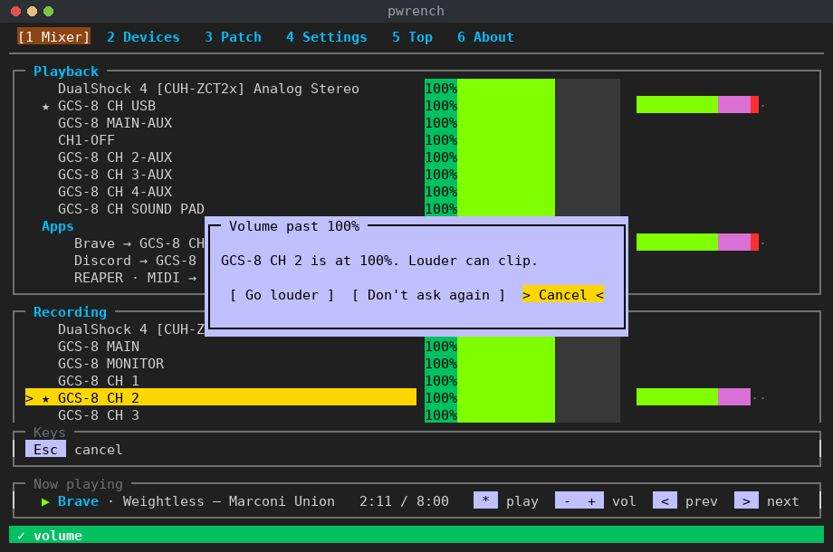

# PipeWrench themes

Every PipeWrench theme is a small text file. Yours live in `~/.config/pipewrench/themes/`, and the ones that
come with PipeWrench are in the `themes/` folder of the repo, in the same format. You can start from any of
them, change a line or two, and pick the result in Settings.

[Quick start](#quick-start) · [How a theme is built](#how-a-theme-is-built) ·
[What each color paints](#what-each-color-paints) · [Every role](#every-role) ·
[Colors and styles](#colors-and-styles) · [`extends` and `logo`](#extends-and-logo) · [Recipes](#recipes) ·
[Checking a theme](#checking-a-theme) · [Back to the user guide](guide.md)

## Quick start

1. Copy a theme you like into a file of your own:

   ```
   pwrench theme export pipeos-dark
   ```

   That writes `~/.config/pipewrench/themes/pipeos-dark-custom.toml`. It never overwrites a file.
2. Open the file and change a line. For an orange cursor:

   ```toml
   selected = { fg = "#000000", bg = "#ff9a1f" }
   ```

3. In PipeWrench, open **Settings → Preferences → Display → Theme** and press Enter. Opening that row reads the theme files again,
   and the status band says how many it found, or what's wrong with one. Pick yours with ←→ and press Enter.

## How a theme is built

A theme has three layers. You only fill in the ones you need.

```
[palette]    named colors           sky = "#00bfff"
     │
[general]    13 base roles           title = { fg = "sky", attr = "bold" }
     │
[specific]   one role per element    head_play, head_src, … follow title unless you set them
```

- The **palette** gives names to colors, so you can write `sky` instead of `#00bfff` everywhere you use it.
- The **general** roles are the building blocks of the whole screen: ordinary text, the cursor, titles, the
  ok, pending and alert states, key chips and volume bars. Change one of these and everything that uses it
  follows.
- The **specific** roles cover one element each, like the Mixer's Playback heading or the chosen button in
  a popover. Each one follows a general role, which the table below names, until you set it yourself.

A whole theme can be this short:

```toml
name = "Studio"           # what Settings shows
extends = "pipeos-dark"   # start from this theme; everything you don't set comes from it

[general]
title = { fg = "#ff9a1f", attr = "bold" }
```

## What each color paints



The picture above uses the theme map, `tools/theme-map.toml`, which is also a complete example theme. It
gives each general role its own color, so you can see which role paints which part of the screen:

| Color in the picture | Role | Where |
|---|---|---|
| brown | `anchor` | the current tab |
| sky blue | `title` | tab names and the Playback / Recording headings |
| gold | `selected` | the cursor row, and the chosen button in the box |
| lavender | `chip` | key chips, and the popover box (`popup` follows `chip`) |
| lime | `ok` | the volume fill (`vol`) and the low part of each meter |
| orchid | `pending` | the middle of each meter |
| red | `alert` | the top of each meter |
| green | `bar_ok` | the status band (`band_ok` follows `bar_ok`) |
| grey | `dim` | the Apps label, the Keys frame, hints |

## Every role

| Role | Layer | Where it shows | Follows |
|---|---|---|---|
| `screen` | general | the whole screen: its background and default text | — |
| `normal` | general | ordinary text | — |
| `dim` | general | hints, secondary text, the empty part of bars | — |
| `selected` | general | the cursor bar: the row the keys act on | — |
| `anchor` | general | a row that's chosen but not active, and the current tab | — |
| `title` | general | section titles and headings | — |
| `ok` | general | values and things that worked | — |
| `pending` | general | unapplied changes and partial states | — |
| `alert` | general | errors and warnings | — |
| `chip` | general | key chips in the Keys box and the media bar | — |
| `bar_ok` | general | Mixer volume bar (block style), up to 100% | — |
| `bar_alert` | general | Mixer volume bar (block style), past 100% | — |
| `bar_dim` | general | Mixer volume bar (block style), muted or empty | — |
| `src` | general | Patch: source dots and outputs (optional) | `ok` |
| `dst` | general | Patch: destination dots and inputs (optional) | `ok` |
| `dst_partial` | specific | Patch: a destination that's partly connected | `pending` |
| `bar_src` | specific | Patch: the cursor in the Sources column | `selected` |
| `bar_dst` | specific | Patch: the cursor in the Destinations column | `selected` |
| `anchor_src` | specific | Patch: the chosen source while you pick a destination | `anchor` |
| `anchor_dst` | specific | Patch: the chosen destination | `anchor` |
| `head_play` | specific | Mixer: the Playback heading | `title` |
| `head_rec` | specific | Mixer: the Recording heading | `title` |
| `head_src` | specific | Patch: the Sources heading | `title` |
| `head_dst` | specific | Patch: the Destinations heading | `title` |
| `vol` | specific | Mixer: the volume bar up to 100% | `ok` |
| `vol_over` | specific | Mixer: the volume bar past 100% | `alert` |
| `dir_out` | specific | Devices: outputs | `dim` |
| `dir_in` | specific | Devices: inputs | `dim` |
| `meter_low` | specific | meters: normal level | `ok` |
| `meter_mid` | specific | meters: past −18 dB | `pending` |
| `meter_high` | specific | meters: past −6 dB | `alert` |
| `band_ok` | specific | the status band when something worked (✓) | `bar_ok` |
| `band_alert` | specific | the status band when something failed (✖) | `bar_alert` |
| `status_line` | specific | the status line: what the selected row is and does (a calm bar) | `anchor` |
| `popup` | specific | popover boxes | `chip` |
| `popup_sel` | specific | the chosen button in a popover | `selected` |

`src` and `dst` are optional. Set them when you want outputs and inputs in their own colors (the pipeOS
themes do: blue and orange). A theme that sets `src` also keeps the dots' color when the cursor passes over
them.

## Colors and styles

Each role is written as `{ fg = "…", bg = "…", attr = "…" }`, for the text color, the background and the
style. You can leave any part out.

- **Colors:** `#rrggbb`; one of the eight terminal colors (`black red green yellow blue magenta cyan white`),
  or a bright one (`brightwhite`…); or a name from `[palette]`. Leaving a color out uses the terminal's own.
- **`attr`:** any of `bold dim underline reverse`, separated by spaces.
- **Hex needs a terminal with 256 colors or more.** On a smaller one the theme falls back to dark and says
  so. A theme that uses only the eight color names works everywhere.
- Bold on black text shows as grey in many terminals, so avoid `attr = "bold"` with `fg = "black"`.
- The ✓/✖ bands (`band_ok`, `band_alert`) are always drawn bold. If a band's text is `black` (or `#000000`)
  on a dark-enough background, PipeWrench draws it white instead, so it never turns grey.

## `extends` and `logo`

- `extends = "name"` starts from another theme, built-in or yours. Without it a theme starts from `dark`.
  Chains work (`a` extends `b` extends `pipeos-dark`), and a loop is reported.
- `logo` picks the About tab's wordmark: `wrench`, `doom`, `slant`, `pipecraft`, `computer` or `ansi`. It
  comes from `extends` when you leave it out.

## Recipes

**Recolor the cursor and nothing else**

```toml
extends = "dark"
[general]
selected = { fg = "black", bg = "yellow" }
```

**A popover that can't be missed**

```toml
extends = "pipeos-dark"
[specific]
popup = { fg = "#000000", bg = "#ffd700" }
popup_sel = { fg = "#ffffff", bg = "#c00000", attr = "bold" }
```

**One color, read by style** (how the Pipe Boy themes work)

```toml
extends = "dark"
[palette]
text = "#3cff62"
back = "#0b1a0d"
[general]
screen = { fg = "text", bg = "back" }
ok = { fg = "text", attr = "bold" }
pending = { fg = "text", attr = "underline" }
alert = { fg = "back", bg = "text" }
```

## Checking a theme

```
pwrench theme list            every theme: built-in or yours, and the colors it needs
pwrench theme check           problems in your themes folder
pwrench theme check FILE      problems in one file
```

If a theme has a problem, that whole theme is left out and the others still load. Each message names the
file and the line, for example:

- `themes/studio.toml: general.chip.bg "blu" is not a color`: a typo, or a palette name that isn't in
  `[palette]`.
- `themes/studio.toml: general.chips is not a general role`: see the table above for the names.
- `themes/dark.toml: "dark" is a built-in theme`: your file has a built-in's name. Name it something else and
  use `extends = "dark"`.
